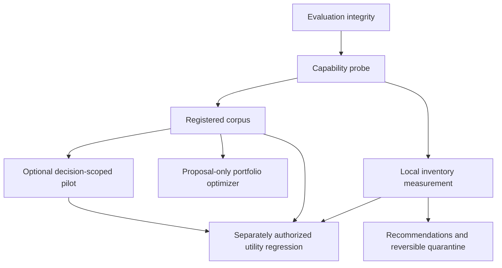

# Development Plan — Armory Package Effectiveness and Skill Inventory

## 1. Context & Source Map

Revision `REV-20261015-skill-inventory`: DESIGN GO — PLAN REVISION: REV-20261015-skill-inventory. R0 #170 landed; the owner accepted the actual M6 checkpoint and authorized M7 under existing incomplete-input refusal gates. The owner explicitly chose to keep code commits local: no product PR publication or merge authority. Live archives remain withheld; regression and all study spend remain deferred. The local M7 catalog registration brings Armory to 145 definitions across seven types, including four utilities; skill-inventory `1.0.0` remains unreleased. Evaluation distinguishes static conformance from NOT_MEASURED effectiveness; read frequency does not establish utility.

| Plan area | Source evidence |
|---|---|
| Evaluation integrity | `scripts/evaluate_package.py:20-116`; merged PRs #107–#108 |
| Runtime declaration | `model_fit.yaml`; `scripts/model_fit.py`; merged PRs #109–#110 |
| Comparative evidence | `evals/skillsbench/README.md`; merged PRs #111–#116; M2/M4 gates remain binding |
| Existing optimizer | `skills/package-optimizer/SKILL.md`; merged PR #118; proposal-only, M3-dependent |
| New product requirements | User request dated 2026-10-15, items (a)–(h), approval gates (1)–(3); local/unpublished owner portfolio analysis, used as hypotheses rather than public evidence |
| Package and integration rules | `CONTRIBUTING.md` §§Package Types, Self-Containment, Versioning, Description Rules; `NEW_PACKAGE_CHECKLIST.md`; `scripts/package_types.py`; `scripts/install.py`; `scripts/generate_adapters.py` |
| Overlap and prior design | The packages in §9; local/unpublished owner context: `.docs/context-audit/SKILL.md`, cleanup-guide PDF, `.docs/MEMENTO_SKILLS_PLAN.md`, `.docs/SKILLSBENCH_EXECUTION_NOTES.md`. These inputs are not distributed with R0; executable requirements are fully stated here. |
| Verification | `justfile:34-71`; `.github/workflows/tests.yml`, `evals.yml`, `package.yml`, `repo-sentinel.yml`; §14 |
| Private discovery evidence | Stage 1 metadata-only probe, 2026-10-15; field contracts in §10. The throwaway instrument and counts remain outside the repository. No real-log fixtures or committed reports. |

### Observed milestone state, not checkbox state

Provider records inspected on 2026-10-15 establish M1 (#107–#108), M2 (#109–#110), and M3 (#111–#112) merged; all checks returned on those PRs succeeded, but historical check sets differ and do not prove checks that never ran. M4 infrastructure (#113–#116) merged; no completed live pilot is established. M5's proposal surface (#118) merged; an approved bounded package revision is not established by that merge. Current `main`, `a5cf296d9fe8f291ca9a95e3a7aa8bd8fb1f23b0`, has eight completed successful check runs, including Tests, packaging, eval/manifest and sentinel checks. PR #104 remains open for issue #102's package-routing boundary harness; issue #103's external-vendoring policy remains open. Neither is replaced by skill utility regression.

Before R0, this plan and its prompts were local ignored files (`.gitignore:80`). R0 force-adds exactly these two authoritative artifacts; the history ledger stays local and excluded. Historical local-only overrides apply only to their named revisions. Owner-authorized R0 publication must pass review and applicable checks and land externally before any product branch; its committed pair is the authority for subsequent execution.
## 2. Assumptions & Gaps

> ASSUMPTION: The implementation must preserve individually installable packages and existing profile-based installation; no change may assume every package body is injected into every turn.

> ASSUMPTION: Tool contracts, irreversible-operation procedures, security constraints, and format-pinning examples are candidates for retention or strengthening, not automatic shortening.

> GAP: M2 supplies a declared target schema and an existing Claude Code target, not a current observed model-fit declaration for the new regression. Refresh client version, exact disclosed model, effort, profile, tool/discovery surface, auth, telemetry and source hashes before M8.

> GAP: M4 has no completed valid pilot result, and its historical isolation-overlay NO-GO is not cleared by merged dispatcher infrastructure. No old subscription or unlimited-budget approval transfers to M8.

> ASSUMPTION: Existing catalog distribution is rolling `latest` on `main` and optional `v*` tags, per `package.yml`; package versions are separate SemVer in definition frontmatter. Do not bump root `pyproject.toml` or invent a repository-wide release. New utility starts at `1.0.0` when cataloged; its package CHANGELOG is included because delivery spans multiple PRs.

> ASSUMPTION: Any future optimizer must use an observed, versioned client/model capability profile and registered task evidence. Static line, word, and token targets are diagnostics only; they cannot authorize a package rewrite.

> GAP: `wrsmith108/claude-md-optimizer` has no repository-detected license despite a README assertion of MIT, and its informal comparison harness is not committed. It is not eligible for vendoring or as Armory effectiveness evidence.

> GAP: Historical main-session OMP prompts are not persisted. Claude skill-listing attachments and Codex developer skill blocks do exist, but neither proves inventory transport on every request; Claude's model-dependent renderer budget can downgrade descriptions to names or truncate content. Unknown exposure is unavailable, not zero. A chars/4 estimate is not measured tokens, cache attribution or dollars. The old ~5% token-share figure is a model, not a reproduced measurement.

> ASSUMPTION: A utility is a new independent milestone, not an automatic M5 portfolio optimization. M6/M7 may supply descriptive evidence to M5; only M8 can establish marginal utility under its recorded configuration. Never-read skills can act through descriptions; the harness's “Matching skill → MUST read” instruction confounds read rate.

## 3. Dependency Graph



## 4. Release Trains

| Target release | Included milestones | Preparation trigger | Required artifacts | Verification | Publication |
|---|---|---|---|---|---|
| `unversioned` existing catalog | M1, M2, M3, M5 | Existing merged implementations; any future approved M5 revision is independently gated. | Package-local SemVer only for changed packages; no root-version change. | Existing package/eval gates in §14 | Existing rolling `latest`; no new release/tag authorized |
| `none` empirical recertification | M4 | Approved decision-scoped pilot, complete receipts and report; still blocked. | Immutable derived evidence, not a package release | M2/M4 telemetry, isolation, completeness and authorization gates | No publication without separate approval |
| `skill-inventory 1.0.0` | M6, M7 | Both milestones complete, reviewed and externally merged; measurement checkpoint accepted before recommendations start. | `UTILITY.md` version, package `CHANGELOG.md`, evals, generated manifest, README catalog/count; no root CHANGELOG mandate | §14 full gates, independent install/run, real aggregate smoke | Existing catalog rolling release; tags and PR merges require separate authorization |
| `none` marginal-utility study | M8 | Current M2 declaration, cleared M4 live-pilot gates, M6 evidence, preregistration and explicit capped spend authorization | Frozen study protocol and immutable derived receipts; no real log data committed | §12 eligibility, paired-arm competence, complete cells, SESOI and kill rule | Private by default; no public empirical claim authorized |

## 5. Plan Evolution Protocol

- The committed plan and prompt files are authoritative. The ignored history ledger is reconstructible local evidence.
- Before each milestone, inspect its current plan/prompt, source map, current codebase, merged predecessor diffs, predecessor verification/CI evidence, and the local history when available.
- Record exactly one `DESIGN GO — PLAN REVISION: none`, `DESIGN GO — PLAN REVISION: <entry IDs>`, or `DESIGN NO-GO — REASON: <blocking evidence>`.
- A material mismatch updates the current milestone and every directly or transitively affected future milestone in both authoritative files. Recompute the dependency graph, critical path, and release-train membership when affected.
- `DESIGN NO-GO` blocks code, branches, and implementation PRs. A material plan revision requires a docs-only reconciliation PR that is reviewed, green, and externally merged before implementation.
- Obtain separate decisions (1) utility build, (2) exact reviewed live OMP archive, (3) regression authority. Stage (3) explicitly separates **3a** no-cost preregistration/eligibility work, **3b** pilot-only cap, **3c** exact sentinel cap, **3d** exact continuation cap. None implies another. Build approval excludes archive, study, publication and merge. Show M6 output and pause for owner acceptance before M7; human gates are not polling targets.

## 6. Sections & Milestones

### Section A — Measurement Integrity

#### M1 — Replace static proxy gates with type-valid effectiveness evidence

| Field | Value |
|---|---|
| Objective | Make the package-quality and eval surfaces distinguish structural validity from package effectiveness. Enforce complete active-package eval coverage and execute negative routing cases rather than automatically passing them. |
| In / Out of scope | In: evaluator dimensions, eval schemas/runners, CI enforcement, tests, and missing eval-case coverage. Out: changing package instructional content except the minimum cases required to establish coverage. |
| Depends on | none |
| Target release | `unversioned` existing catalog |
| Deliverables | A type-specific evaluation contract; static scoring that no longer awards quality points solely for word count, formatting, or quoted-trigger count; executable positive and negative routing assertions; complete active-package eval coverage; CI that fails rather than warns on missing active-package cases. |
| Acceptance | Every active package has valid cases; negative routing can fail; all seven types use relevant contracts; static conformance is separate from live effectiveness. Historical M1 baseline was 141 definitions, 133 active and 8 deprecated, not a fixed future count. |
| Verification | `uv run python scripts/validate_evals.py`; `uv run python -m pytest tests/test_run_evals_history.py tests/test_package_types.py tests/test_evaluation_contracts.py tests/test_validate_evals.py`; invalid/missing-case fixtures fail. |
| Design reevaluation | Reconfirm package-type semantics, current client activation behavior, and all M2-M5 assumptions. If semantics change, review M2, M3, M4, and M5. |
| Risks & rollback | Treat evaluator output format as a public CI/reporting contract. Preserve machine-readable fields or version the format; revert the implementation stack as one unit if existing install or CI consumers break. |
| Est. PRs | 2 |

#### M2 — Build a declared model-fit and runtime-disclosure probe

| Field | Value |
|---|---|
| Objective | Establish what each supported client actually exposes on a turn and record a reproducible model, effort, profile, tool-surface, and disclosure matrix before attributing token or quality effects to package text. |
| In / Out of scope | In: a probe harness, configuration schema, dry-run validation, capture format, and documentation generated from observed behavior. Out: modifying package body content or claiming cost savings without observed token accounting. |
| Depends on | M1 |
| Target release | `unversioned` existing catalog |
| Deliverables | A model-fit probe with explicit target configuration; a profile/install-state manifest; a stable evidence schema for model/client version, effort, installed packages, disclosed metadata, token fields when available, wall time, and tool surface; loud failure when required telemetry is absent. |
| Acceptance | The probe rejects undeclared model or profile inputs; dry-run verifies every configured profile resolves to installed package definitions; live mode never substitutes a missing telemetry field with an estimate; output distinguishes discovery metadata from loaded package bodies. |
| Verification | Targeted probe tests exit 0; `uv run python scripts/validate_evals.py` exits 0; a dry-run command documented by the new probe exits 0 for `core` and `full` profiles; a deliberately incomplete target configuration exits non-zero with the missing field named. |
| Design reevaluation | Reconfirm M1’s eval contract and the supported clients/models before implementation. If a client cannot expose a required value, update M3-M5 to use only observable metrics rather than proxy estimates. |
| Risks & rollback | Client CLI output and telemetry may be unstable. Version the capture schema, retain raw receipts where permitted, and fail loud rather than fabricating comparative token data. Roll back the probe stack if it modifies normal installation behavior. |
| Est. PRs | 2 |

### Section B — Controlled Evidence

#### M3 — Register a representative benchmark corpus and package strata

| Field | Value |
|---|---|
| Objective | Maintain the registered, artifact-verifiable corpus that distinguishes package detail effects from prose-only scoring; the merged corpus contains 50 tasks rather than only the five historical seeds. |
| In / Out of scope | In: task eligibility, package strata, expected artifacts, scoring criteria, repeated-run policy, and corpus validation. Out: paid live execution and any portfolio-wide package rewrite. |
| Depends on | M2 |
| Target release | `unversioned` existing catalog |
| Deliverables | A frozen task manifest with at least 50 tasks before any portfolio-level verdict; a stratified package sample covering all seven types and high-risk instruction surfaces; artifact-aware success criteria; declared baseline, treatment, repetition count, and exclusion rules. |
| Acceptance | Every task maps to an observable success criterion; every package stratum has an explicit inclusion rationale; the corpus validator rejects undeclared cells and tasks that only inspect assistant prose when an artifact is the intended deliverable; the comparison includes current, reduced/rewritten, and strengthened-contract conditions where applicable. |
| Verification | Corpus and SkillsBench unit tests exit 0; the task-manifest validator exits 0; `uv run python scripts/run_skillsbench.py --dry-run` exits 0 for the declared corpus; a fixture with an undeclared cell or prose-only artifact claim fails validation. |
| Design reevaluation | Reconfirm M2’s observable metrics and declared model matrix. If task or package selection changes, update M4 sample size, stopping rules, and all M5 scope claims. |
| Risks & rollback | Synthetic tasks and text-only assertions can produce false confidence. Require artifact checks where the outcome is an artifact, predeclare exclusions, and keep the existing seed harness usable until the new manifest passes validation. |
| Est. PRs | 2 |

#### M4 — Execute the approved current-model comparative pilot

| Field | Value |
|---|---|
| Objective | Periodically recertify selected high-risk package families against a newly available model/capability profile when existing package evidence cannot decide a concrete revision. |
| In / Out of scope | In: opt-in, profile-scoped comparative studies for selected families; derived receipts; failure taxonomy; and targeted recertification reports. Out: a mandatory portfolio-wide benchmark gate, control-plane work without a package decision, automatic package edits, and pooled cross-model claims. |
| Depends on | M3 |
| Target release | `none` empirical recertification |
| Deliverables | An optional, bounded recertification protocol that `package-optimizer` may request for a named package family; target-scoped derived receipts; and a report that is evidence for—not a prerequisite to—package optimization. |
| Acceptance | Name the package decision before launch; freeze target/condition cells; retain every cell outcome; no cross-profile transfer. Require current M2 declaration, actual mechanism engagement, controlled ambient context/MCP/approval surface, explicit spend/privacy/retention approval and a complete pilot before any verdict-bearing extension. |
| Verification | Existing no-cost input, result and dispatcher preflights in §14 pass; the selected study has complete immutable receipts and reproducible aggregation. A preflight does not clear the historical live-isolation NO-GO or prove a pilot was run. |
| Design reevaluation | Reconfirm existing evidence cannot resolve the named decision; recheck isolation, auth, current model, source/condition hashes and all operational approvals. Supersede rather than overwrite a changed study. Review M8 after any change; M5's proposal-only operation remains independent. |
| Risks & rollback | Infrastructure can displace package improvement. No live work before gates clear; retain invalidated evidence without treating it as valid. No old 900-cell authorization transfers to this revision. |
| Est. PRs | 1 |

### Section C — Evidence-Gated Portfolio Action

#### M5 — Classify and optimize the portfolio only where evidence warrants it

| Field | Value |
|---|---|
| Objective | Provide `package-optimizer`: an ongoing, approval-gated surface that evaluates one package or bounded family from existing evaluator evidence and a capability profile, proposes retain/simplify/strengthen/retire/inconclusive, and applies no edit without explicit approval. |
| In / Out of scope | In: proposal-only package evaluation, evidence records, capability-profile registry, stale/incomparable evidence refusal, before/after preservation, and opt-in approved family revisions. Out: mandatory M4 completion, portfolio-wide automatic edits, blanket shortening, static size thresholds as policy, deletion of load-bearing contracts, or unsupported effectiveness claims. |
| Depends on | M3 |
| Target release | `unversioned` existing catalog |
| Deliverables | `package-optimizer` skill and evals; a local evidence record for one package/family; proposal output with evaluator evidence and a no-edit default; explicit approval flow; and a recertification request format for cases where current evidence is inconclusive. |
| Acceptance | The optimizer selects the smallest bounded package scope; cites existing structural and behavioral evidence; produces a retain/simplify/strengthen/retire/inconclusive proposal; refuses stale/missing/incomparable profiles; never edits without explicit approval; preserves before/after artifacts; and runs the existing package evaluator after an approved edit. |
| Verification | Optimizer tests reject missing/stale/incomparable evidence and unapproved edits; the first optimized package passes its package evaluator and relevant eval cases; proposal output is deterministic from recorded evidence; a recertification request names the unresolved package decision. |
| Design reevaluation | Reconfirm the selected package family, available evaluator evidence, and capability-profile comparability before an approved edit. An optional M4 report can enrich but never block an otherwise evaluator-backed package optimization. |
| Risks & rollback | An optimizer can turn weak evidence into overbroad edits. Default to proposal-only, scope one package/family, retain before artifacts, revert the approved family change on regression, and leave inconclusive packages unchanged. |
| Est. PRs | 2 |

### Section D — Installed Inventory, Not Portfolio Rewriting

#### M6 — Measure installed inventories and observed skill events locally

| Field | Value |
|---|---|
| Objective | Deliver a deterministic offline CLI measuring OMP first, then Claude Code and the actual Codex skill surface, with explicit coverage limits and aggregate-only output. |
| In / Out of scope | In: versioned adapters, installed/disclosed separation, chars and labeled estimates, read/invocation events, first-seen/last-read/creation provenance, reproducible snapshot method and synthetic fixtures. Out: recommendations, archives, network, LLMs, utility/effectiveness claims. |
| Depends on | M2 |
| Target release | `skill-inventory 1.0.0` |
| Deliverables | Package-local measurement engine/tests/schema docs; PR-1 includes runnable OMP measurement, 2+ positive/2+ negative eval cases and utility CI lint/type gate so every prefix is green. PR-2 adds Claude/Codex observations. No repository/sibling runtime imports; defer the installable definition until M7 PR-3. |
| Acceptance | Same immutable input and as-of/window/config produce byte-stable sorted reports; unknown/malformed schema exits nonzero; missing exposure never becomes zero; read attempts and successful resolutions differ; main/sub/unknown cohorts reconcile; no private values in stdout/errors. Show the owner real local aggregate output and STOP for review before M7. |
| Verification | §14 lint/format/strict types and M6 targeted tests; synthetic malformed/missing/duplicate/cache fixtures; offline real-log `measure --aggregate-only` smoke; immutable-snapshot repeat yields identical aggregate JSON. |
| Design reevaluation | Pin observed client schemas and ownership roots before implementation. Review M7/M8 on schema, counting, exposure or cohort changes. No portable per-request exposure guarantee where logs omit it. |
| Risks & rollback | Active logs, compaction, retries and prompt-injected `skill://` can inflate counts. Freeze input prefixes and identity rules; refuse mutation-bound reports. Roll back M6 as one stack; real logs remain untouched. |
| Est. PRs | 2 |

#### M7 — Propose inventory actions and support reversible managed-only quarantine

| Field | Value |
|---|---|
| Objective | Ship `utilities/skill-inventory` with conservative keep/archive/merge proposals and an explicit, reversible OMP managed-skill archive/restore operation. |
| In / Out of scope | In: §11 classification/similarity/review, OMP archive/restore, package integration and §13 dogfood. Out: auto-merges, user-skill edits, deletion, any Claude/plugin/Codex mutation, model scoring or paid utility studies. |
| Depends on | M6 |
| Target release | `skill-inventory 1.0.0` |
| Deliverables | Functional recommendations and synthetic-root archive/restore; utility `1.0.0`, package CHANGELOG, completed evals, manifest/catalog/count update, explicit exclusion from the existing SkillsBench sample, Cursor/Codex skips and Gemini utility-as-skill wrapper validation. |
| Acceptance | No mutation by default; incomplete coverage/unknown age/pins/high-risk or dependent references stay kept; merge proposals never apply. Archive refuses protected roots, links, conflicts, changed hashes/listings, missing quiescence attestation and unapproved sets. Interrupted actions recover without overwrite. Live dogfood needs separate approval (2). |
| Verification | §14 full local gates, temporary-root archive/crash/restore scenarios, independent unpacked-package fresh-context run, real aggregate smoke and privacy review; live archive not required for package correctness and never implicit. |
| Design reevaluation | Require owner acceptance of M6 output before work starts. Reconfirm exact managed path, file ownership, quarantine set/size and restore procedure before any archive. Review M8 if ranking/population changes. |
| Risks & rollback | Rare safety rules, description-only steering and narrow observation windows produce false positives. Keep guards, explicit human choice, staged batches, 21-day quarantine and exact restore; uninstall/revert utility without touching logs. |
| Est. PRs | 3 |

#### M8 — Test marginal utility only under separately authorized live gates

| Field | Value |
|---|---|
| Objective | Decide whether a narrow withheld-versus-injected regression is worth retaining, without making it a dependency of the inventory utility. |
| In / Out of scope | In: §12 frozen full high-read population, replayable public-repo tasks, registered SESOI, paired arms, capped pilot, top-20 sentinel kill stage and immutable derived receipts. Out: live-log task export, employer tasks, external vendoring, automatic pruning and pooled cross-model claims. |
| Depends on | M6, M3, M4 |
| Target release | `none` marginal-utility study |
| Deliverables | PR-1 public preregistration plus private full-history ranking/eligibility builder using M6 adapters and no-cost simulation/preflight; PR-2 execution/analysis code and anonymous verdict only. User's ~32 is a prior hypothesis; K is fixed only by the committed method at accepted M6 cutoff. Receipts/ranking remain private. |
| Acceptance | Freeze all K, ≥10 confirmatory tasks each and three paired repetitions before outcomes. Sentinel counts either signed endpoint crossing under §12, including harms; quality noninferiority gates benefit labels, not crossing count. Fewer than3/20 kills regression; mechanical-only survival never automatically continues. Require separate stage caps and arm isolation. |
| Verification | Private population/cell commitment, complete eligibility and viable null/large-effect simulations; refreshed M2, completed separate M4 pilot and approved 3a/3b/3c/3d as applicable. Private immutable receipts and paired/repo-aware uncertainty; no missing, duplicate or undeclared cells. |
| Design reevaluation | Recheck model, separate M4 pilot, task/noise feasibility, body engagement and budget before action. To repair eligibility before outcomes, add eligible tasks only: no skill removal, replacement, reranking, minimum reduction or K truncation. Insufficient identifiable history/tasks/noise precision is INFEASIBLE and drops the study, not the utility. |
| Risks & rollback | Ten tasks cannot establish equivalence or general utility; heavy-tailed tokens and correlated repos limit inference. Treat kill as an operational investment decision, not a universal null claim. Archive study receipts privately and stop spending on kill/cap/global failure. |
| Est. PRs | 2 |

## 7. Cross-Cutting Concerns

- **Model specificity:** Every empirical conclusion is scoped to recorded model, client version, effort, profile, and tool surface. No result transfers automatically to another model generation.
- **Cost and privacy:** Live runs require an approved budget, disclosed logging posture, and a raw-receipt retention policy. Missing telemetry is a measurement failure, not zero cost.
- **Safety:** Tool-contract detail and destructive-operation procedures remain subject to contract/safety verification even when their prose is reduced.
- **Reproducibility:** Freeze task × condition × model cells before results are visible; preserve source revisions and raw receipts; reject partial matrices.
- **Documentation honesty:** Do not claim 100% eval coverage, battle-tested effectiveness, or model-drift detection until tracked evidence establishes each claim.

## 8. Critical Path

| Order | Milestone | Exit condition |
|---|---|---|
| 1 | M1 → M2 → M3 | Merged integrity, declaration and corpus implementations; refresh runtime observations before live studies. |
| 2 | M3 → M5 | Proposal-only optimizer already merged; every applying revision still needs explicit bounded approval. M4 is not a mandatory predecessor. |
| 3 | M2 → M6 → M7 | New deterministic utility path; build approval and merged docs reconciliation first; owner review of real measurement output between M6 and M7. |
| 4 | M3 → M4 → M8, plus M6 → M8 | Optional live path; current model-fit, cleared isolation/pilot, preregistration and spend authorization remain required. No critical-path dependency from M8 to M7. |
| 5 | M6 + M7 | Utility package train complete; catalog distribution only after separately authorized PR publication/merges. Live dogfood and M8 are not automatic release prerequisites. |

## 9. Package Shape and Overlap

Choose a **utility**, `utilities/skill-inventory/UTILITY.md`, with package-local scripts/references/tests/evals and CHANGELOG. Frontmatter: `name`, `description`, `type: utility`, metadata version `1.0.0`, category `operations`, tags `[skills, inventory, usage, privacy, quarantine]`, difficulty `intermediate`, and `utility: {runtime: python, entry_point: scripts/skill_inventory.py, executable: true}`. Use Python 3.12+, standard-library log/action code and `PyYAML==6.0.3` for frontmatter, not an invented YAML parser. Declare dependencies through PEP 723. Bootstrap: `uv run --no-project --script "$UTILITY_ROOT/scripts/skill_inventory.py" --help`; this may fetch dependencies but never opens logs. Measurement/actions use `--offline --no-project --script` and fail if prerequisites are unavailable. Validate unpacked without the repository environment. No vendored code or cross-package import.

No exact `skill-inventory` name exists in the current manifest. Do not add a same-name command or auto-loaded skill just to invoke deterministic code. Extending `usage-audit` would couple the tool to `/context` and general settings advice; `skill-library` owns remote catalog/install lifecycle; a command alone does not supply the standalone engine. A future prompt-driven wrapper requires a separate demonstrated need.

Proposed description: “Measures installed skill metadata exposure and observed reads or invocations from local OMP, Claude Code and Codex logs. Use this utility when you ask ‘audit my skill inventory’, ‘how much do skill descriptions cost?’, ‘find unused managed skills’, ‘which skills were read?’, ‘find duplicate skills’, or ‘restore archived skills’. Covers offline measurement, conservative archive/merge proposals and reversible OMP managed-skill quarantine. NOT for general session/context audits (usage-audit), catalog installation (skill-library), or static package quality/effectiveness scoring (package-evaluator).”

| Existing surface | Already covers | New utility boundary |
|---|---|---|
| `skills/usage-audit` | `/context`-gated setup audit; MCP, instructions, skills, settings, permissions | No replacement of its general audit; metadata exposure is not body-line “bloat” scoring |
| `skills/skill-library` | Catalog/local comparison, list/search/install/update/remove | No remote catalog fetch/install/sync or destructive removal |
| `skills/package-evaluator` | Package structural/quality rubric | No quality score from usage or exposure |
| `skills/skill-distiller` | One-skill cross-model rewriting/trace validation | No rewriting, model calls or distillation |
| `skills/immune` and scripts | Output scanning and task-conditioned immune-memory retrieval | No immune-memory scoring or repository-root `task_signature` import |
| `agents/skill-librarian` | Explicit lesson capture, observation queue and approved review | No automatic surveillance, observation-queue replacement or skill generation |
| `agents/skill-router` | Outcome-history package routing | No trained/LLM routing, routing changes or router-index edits |
| `hooks/cost-tracker` | Session/tool token estimates and repeated-read waste signals | Inventory exposure is separate from session billing |
| `hooks/prompt-context` | Per-prompt configured context injection | No injection or settings edits |
| `hooks/read-dedup` | Session-local repeated-file warnings | Repeated reads, invocations and successful body loads remain different events |
| Local context audit and Cleanup Guide | General context hygiene and settings advice | Not authoritative evidence of cache cost or utility; fixed line/word thresholds cannot authorize pruning |
| `skills/package-optimizer` (M5) | Approval-gated package/family proposals from evidence | Utility supplies descriptive inventory evidence, never an effectiveness disposition |

Native Armory installation copies the utility to `~/.claude/utilities/skill-inventory`; the `.utility` archive runs standalone. Cursor and Codex generators skip utilities. **Gemini wraps utilities as skills** (`generate_adapters.py:572-574`): preserve/validate its relative script invocation, copied dependency metadata and one added discovery description. Do not claim zero Gemini metadata overhead or add a generator opt-out. OMP/Claude/Codex are input adapters, not new agent-execution support. Regenerate/validate all three platform outputs; canonical scripts remain package-local.

## 10. Measurement, Schema and Privacy Contract

All operations are local/deterministic: no network, LLM, collector, daemon, execution from logs or automatic config changes. CLI: `measure`, `recommend`, `archive --dry-run`, explicit `archive --apply`, `restore --list`, `restore --dry-run`, explicit `restore --apply`; item restore supports repeatable `--item`. Only complete `measure` ships in M6; M7 adds the remaining complete operations, not placeholders.

Default read-only log roots are `~/.omp/agent/sessions`, `~/.claude/projects` and `~/.codex/sessions`; inventory roots are pinned below. Scan only newline-complete JSONL prefixes, not blobs or sidecar conversation exports. Additional archived/project roots require explicit approved inputs; never traverse a project or execute a path merely because a log's cwd/tool argument names it.

### Normalized output

Version the output schema and every input adapter. Record harness, schema identity, input snapshot policy, UTC as-of/window, aggregate cohort/file/event counts, installed versus observed inventory, exposure scope and unavailability reasons, chars, `token_estimate_chars_div_4`, optional actual usage fields and measured-versus-modeled cache status. An explicit local private report may enumerate **installed-file-sourced** skill identities; stdout/public output defaults to aggregates. Keep first observed inventory date, first read, last read and creation date separate, each with source and unknown status. Filesystem birth time is installation evidence, not authored creation. No mtime-as-creation or unread-as-useless substitution.

Count assistant tool-call events, never textual `skill://` mentions. Preserve main/subagent/unknown cohorts and reconcile unions; distinguish files, session identities, attempts, deduplicated call IDs, successful tool-result resolution, body loads and native invocations. Duplicate IDs with conflicting payloads fail. Events for absent/uninstalled/renamed skills are unresolved, not assigned to the current same-name file without provenance. Unknown versions, malformed complete JSON, wrong typed fields and missing required discriminators fail nonzero with only anonymous error codes and counts. A wholly absent exposure field has explicit `unavailable`, not a successful zero. Recognized unrelated record types may be ignored with counts; unknown tool-event shapes cannot.

For live logs, freeze sorted file identities and byte lengths at scan start, read complete lines only inside those bounds, and record new/appended/changed files anonymously. Do not read appended text or silently ignore malformed complete lines; exclude only the final incomplete line with an explicit diagnostic. Detect rewritten/truncated input and invalidate the snapshot. A stable closed-file snapshot is required for recommendations or mutation authorization. Store snapshot bindings privately outside the repository; stdout exposes no file hashes that enable content correlation. Fixed input, policy, clock and sorting reproduce exactly. The committed M6 script and synthetic fixtures are the reproducible method; Stage 1's throwaway probe is not misrepresented as committed code.

### Per-harness contract

| Adapter | Inventory exposure | Events and observations | Ownership / mutation |
|---|---|---|---|
| OMP first | `type=session_init`, top-level `systemPrompt` string or ordered string list; extract exact tagged skills block, wrapper and entry spans separately. Header `type=session`, `version=3`; optional `session_init.runtime.version`. Main prompts unavailable. | `type=message`, `message.role=assistant`, `message.content[].type=toolCall`, `.name=read`, `.arguments.path` starting `skill://`; link `message.role=toolResult` via `toolCallId` and `isError`. Also direct installed-SKILL.md Read attempts and recognized user slash loads; `autoloadSkills` references are protected dependencies, not inferred successful loads. | Managed location is not per-file authorship proof; require generated-only attestation. Protect `~/.omp/agent/skills`, any configured resolved target, and shared `~/.agents/skills`. |
| Claude Code second | `type=attachment`, `attachment.type=skill_listing`, `.content`, `.names[]`, `.skillCount`, `.isInitial` are listing snapshots. Detect truncation/count mismatch; no assumed per-request repetition. Top-level `version` is client identity. | `type=assistant`, `message.content[].type=tool_use`, `.name=Skill`, `.id`, `.input.skill`, optional `.input.args`; native invocations separate from direct Read attempts. Deduplicate streamed/forked copies by declared session/message/tool identity, including usage chunks. | Personal/project/cross-runtime links and plugin install roots from `~/.claude/plugins/installed_plugins.json` protected; no generic auto-learned owner assumed. |
| Codex (real surface verified) | `type=response_item`, `payload.type=message`, `payload.role=developer`, `payload.content[].type=input_text`, `.text` contains skills-instruction blocks. Version `session_meta.payload.cli_version`. Instruction fields in `turn_context.payload` and `session_meta.payload.base_instructions.text` are separate sources. | `response_item.payload.type=function_call`, `.name`, JSON `.arguments`, `.call_id` is the function envelope, not proof of a skill load. Native skill read/invocation counts are initially `unavailable`: a `SKILL.md` mention is not a read. Preserve fork/subagent/compaction lineage. | `~/.codex/skills` and its configured resolved targets, shared `~/.agents/skills`, plugin skills under `~/.codex/plugins`, and project `.agents/skills` all protected; no managed archive owner established. |

OMP prompt string lists retain order: measure each original string, and map tagged spans in their newline-joined view back to original segments; report inserted separator chars separately, not as persisted prompt bytes. Actual snapshot token signals are `message.contextSnapshot.{promptTokens,nonMessageTokens}` and do not attribute inventory cost. User slash-load schemas from the installed OMP 18.11.0 consumer are `type=custom_message`, top-level `customType=skill-prompt`, `attribution=user`, `details.name`, or `type=message` with `message.role=custom` and the same fields under `message`. M6 must validate these shapes with synthetic fixtures and local aggregate-only observation; absence of observed instances means no measured invocations, not an assumed bypass count. Direct reads, slash invocations and agent `autoloadSkills` references keep affected skills protected from archive.

Claude listing content is a lower-bound snapshot when descriptions are downgraded to names under the model-dependent renderer budget, a truncation marker appears, names/content mismatch or count disagreement is present. The previously observed ~30k-character size is not a universal cap or threshold. Report chars, names length and skillCount separately; noninitial listings are partial observations, not additive initial exposure or an assumed replacement. Preserve pooled observations but provide source-separated counts, monthly medians and latest observations so dynamic listings cannot masquerade as initial request exposure. Preserve each Codex timestamped tagged-block observation rather than collapsing within-session snapshots or summing them into request charges; discard surrounding text. Resolve aliases once per harness view and report duplicate visibility anonymously. Actual discovery counts stay in the owner packet; schema/client-version allowlists are compatibility metadata, not per-version usage reports.

Codex compaction preservation includes `type=compacted`, `replacement_history[]` developer messages with `content[].type=input_text` and `.text` containing the same skill blocks. This is a separate physical disclosure source, not a new request. Every physical token-count observation remains distinct even when counter values repeat; separate fork-lineage telemetry, last-counter sums and per-session cumulative maxima, with no billing attribution or inferred new-request count. Native read/invocation counts and dates remain unavailable, including in private installed-skill output.

Summary-only Codex compactions require a string `message` but may omit `replacement_history` or set it to null; count that known absence without inventing a disclosure or inspecting the summary. Present histories stay typed and strict.

Native inventory discovery is an approved local file view, not native enabled/disclosed visibility. Claude's exact version-2 installed-plugin registry authorizes install bases; optional `.claude-plugin/plugin.json` custom skill directories supplement default `./skills`. Codex personal/system/shared roots and manifest-backed versions under `~/.codex/plugins/cache` are protected cached-file views, including stale/disabled versions, never active selection. A present remote-install marker requires schema `1`; hidden staging outside the cache layout is not scanned. Bound recursive traversal and manifest containment; missing declared resources, unknown versions and unresolved namespace/alias conflicts block complete coverage. No additional mutation authority follows.

Codex plugin namespaces use the manifest name. Absent/empty declared skill lists fall back to optional `./skills`; declared paths replace rather than supplement that convention. Malformed values/paths fail closed. The supported cache view covers `.codex-plugin/plugin.json`; alternate native manifest layouts fail as incomplete, and command-derived skills outside approved file roots remain unmeasured.

Observed OMP schema set is `{3}`; optional init runtime identity allowlist is exactly `18.11.0, 18.11.1` (exact strings, no ranges; the actual parsed identity is preserved and any other value fails closed; non-material compatibility metadata, schema unchanged, no M7 authorization); absence of that optional runtime field is valid schema-v3. Observed Claude identities: `2.1.258, 2.1.263, 2.1.272, 2.1.273, 2.1.274, 2.1.276, 2.1.278, 2.1.280, 2.1.281, 2.1.282, 2.1.283, 2.1.284, 2.1.285, 2.1.286, 2.1.287, 2.1.288, 2.1.289, 2.1.290, 2.1.291, 2.1.292, 2.1.293, 2.1.294, 2.1.295, 2.1.296, 2.1.299, 2.1.300, 2.1.301`. Observed Codex identities: `0.39.0, 0.57.0, 0.77.0, 0.79.0, 0.80.0, 0.94.0-alpha.10, 0.98.0, 0.100.0-alpha.10, 0.101.0, 0.107.0, 0.112.0, 0.114.0, 0.115.0-alpha.4, 0.116.0, 0.118.0, 0.118.0-alpha.2, 0.120.0, 0.122.0, 0.124.0, 0.128.0, 0.128.0-alpha.1, 0.129.0, 0.130.0, 0.131.0, 0.133.0, 0.134.0, 0.135.0, 0.136.0, 0.137.0, 0.144.1, 0.153.4`. These are observed identities, not untested support promises: admit each version/shape pair only with synthetic coverage in M6; reject unknown identities/shapes deliberately, not through permissive ranges.

Actual usage paths: OMP `message.usage.{input,output,totalTokens,cacheRead,cacheWrite,cost}`; Claude `message.usage.{input_tokens,output_tokens,cache_read_input_tokens,cache_creation_input_tokens}` and `.cache_creation.ephemeral_5m_input_tokens` / `.ephemeral_1h_input_tokens`; Codex `type=event_msg`, `payload.type=token_count`, `payload.info.last_token_usage.{input_tokens,cached_input_tokens,output_tokens,reasoning_output_tokens,total_tokens}` versus `.total_token_usage`. Never sum last and cumulative counters or repeated Claude message IDs together. None attributes cache reads to a particular skill block.

The private census detected malformed OMP Read-path and epoch fields; counts stay in the owner packet. It did not establish shipped strict-parser success. Product measurement emits nonzero aggregate-only incomplete status on relevant malformed input and blocks recommendations/actions. Select an explicit valid closed cohort or approve a narrow versioned legacy-exclusion policy retaining excluded counts; never rewrite logs/drop records to turn smoke green. For M8, ambiguous/excluded records that could change ≥20 membership or which skills fall in the top 20 (the rank-20/21 boundary) make ranking INFEASIBLE. Unknown skill-loading shapes invalidate coverage; unrelated new tool names do not.

### Cache and cost

Report actual input/output/cache counters only when persisted; label provider receipts and local cost estimates distinctly. Whole-request cache hits do not prove the skill block was cache-read. Skill-specific cache exposure/dollars require actual attributable fields; otherwise show a separately labeled cold/cache-hit sensitivity model, not a saving. The chars/4 divisor is fixed and labeled, not a tokenizer. Do not repeat the prior modeled ~5% token-share figure as a measurement. No n=1 generalization and no read-frequency-to-quality inference.

### Privacy

Read approved local roots and reduce records to allowlisted metadata in memory. Never persist prompts, conversation bodies, titles, cwd/project paths, session IDs, raw events, raw log-derived skill names or arbitrary tool arguments; never expose them in stdout, errors, repository, fixtures, PRs or public reports. Explicit local private skill reports may use identities sourced from installed files. Narrow exceptions outside the repository: the private snapshot binding stores opaque local file identities/lengths and locally keyed integrity digests, not log content/raw log hashes; the private archive manifest stores installed-file identities/paths/hashes/modes and approval/journal states; the separately approved private study registration stores installed identities, derived counts and public task cells. These are not public reports. No conversation text or employer/project identifiers enter any exception. The owner packet contains anonymous aggregate counts/schema keys only; compatibility version allowlists may ship without per-version usage counts. Regression tasks come from explicitly selected public revisions, not logs.

## 11. Recommendation and Reversible Action Contract

Window default: 90 days ending at an explicit UTC `--as-of`. Both never-read and rare candidates require ≥90 days of reliable first-observed/install-age lower bound and at least 20 observed inventory-present subagent snapshots across five main-task groups. Show calendar coverage, inventory-present opportunities, cohorts and gaps separately; main-session presence is unmeasured/modeled, never silently included. Never-read means zero observed loads/invocations across supported channels in that window, not lifetime zero. Rare means 1–2 loads, last ≥60 days old, and a window spanning at least twice the largest observed inter-use gap; insufficient history or a periodic release/incident workflow stays keep. Authored creation may be unavailable; display it as unknown instead of converting birthtime to creation. A reliable observation lower bound can establish age without authored creation.

Classification precedence: **keep** for user/unknown ownership, pinned/high-risk safety coverage, insufficient age/coverage, aliases/links, active references/dependents or unresolved provenance; otherwise **merge candidate** when similarity clears the rule below; otherwise **archive candidate** for never/rare evidence; otherwise **keep**. Include reasons and counter-evidence. Description-only influence is unobserved and requires a human “coverage still needed?” decision; recommendation alone never authorizes mutation.

Mandatory private inputs: versioned pin file explicitly empty/nonempty, generated-only attestations, approved instruction/agent-definition paths and all resolved discovery roots. High-risk rule v1 matches casefolded whole tokens in names/descriptions/headings against `[auth, authentication, approval, security, secret, secrets, privacy, permission, permissions, irreversible, payment, payments, migration, release, publish, restore, benchmark, provenance]`, forcing keep. Scan installed bodies and approved instruction/agent files for explicit references, slash invocations and `autoloadSkills`. Missing inputs, unresolved roots, incomplete channels or unreadable references mean keep, not an empty protection set.

M7's versioned private policy/proposal fields bind explicit pins, exact source-tree digests, generated-only/never-user-authored assertions, historical-identity-since assertions, periodic-workflow review and the description-only coverage decision. Owner assertions are labeled attested, not cryptographic verification or measured utility. They do not override unresolved discovery, aliases, missing policy/reference inputs or incomplete measurements. Revalidate installed metadata after proposal construction, then rebuild the proposal from fresh measurement and the same bound policy inputs before archive; changed policy, tree, listing or proposal digests refuse mutation.

Opportunity evidence counts distinct logical subagent sessions conservatively rather than repeated init records from one session. Prove an OMP main-task group only from captured filesystem hierarchy with its matching parent main file also captured; unknown/conflicting groups cannot inflate counts. Raw log identities and RAM-only opaque group keys never enter reports or proposals. Anonymous daily observation totals count each proven session's earliest complete inventory observation, so continuing old sessions cannot satisfy a later batch's ordinary-session dwell.

Preserve anonymous counter-evidence when valid captured skill activity or results occur after the selected as-of cutoff. Historical M6 window measurement remains valid for its declared time, but missing/positive post-cutoff evidence forces M7 keep/refusal: a historical cutoff cannot authorize movement while the captured prefix already contains later activity. This does not alter M8's frozen historical URI-attempt endpoint.

Recognized OMP autoload and agent-injection dependencies produce only an installed-name private `log_observed_dependency` boolean, never a raw log-name export. True protects the skill even with zero reads or invocations; missing evidence also keeps it. This conservative protection applies across valid captured records, while post-cutoff activity remains a separate refusal. Individual archive/restore moves must use native atomic no-replace rename on Darwin/Linux, including empty concurrently created destinations, with no non-atomic fallback; mutable journals use atomic replacement instead. A planned item with no archive copy that was never moved remains in place when edited and can be closed as restored without modifying its bytes.

Similarity is deterministic, package-local and versioned: Unicode casefold; tokenize names on hyphens/nonalphanumerics and descriptions/headings on nonalphanumerics; remove a small frozen stopword list; weighted Jaccard `0.4 name + 0.4 description + 0.2 section headings`; candidate threshold ≥0.70. Empty features contribute zero, not perfect similarity. Canonical stable pair order, no transitive automatic cluster collapse, embeddings or LLMs. Show which features matched and where scopes/negative boundaries differ. Treat the named ablation, provenance, codec/encoder and pilot-sample-size groups as hypotheses for review, not guaranteed duplicates. No body merge is implemented or auto-applied.

Protected roots: OMP user `~/.omp/agent/skills`; Claude personal `~/.claude/skills`, project `.claude/skills` and plugin install paths from installed metadata; Codex `~/.codex/skills`, plugin skills under `~/.codex/plugins`, shared `~/.agents/skills` and project `.agents/skills`. A configured root symlink resolves once to its target, which stays protected; never silently skip the entire OMP user inventory. Deduplicate aliases by resolved identity. Inner links cannot widen traversal or become mutation candidates. Additional approved roots stay protected; unresolved/unreadable roots block archive recommendations. Armory installation does not imply disposable ownership.

OMP's only mutating path is a documented same-filesystem move from `~/.omp/agent/managed-skills` to **`~/.omp/agent/skill-inventory-archive/<run-id>/skills/<name>`**, outside its fixed managed discovery root. Existing files have no generation marker: keep until the owner attests each selected file was harness-generated and never user-authored, bound to the proposal digest/private manifest. Root location alone never authorizes movement. Harness `manage_skill` delete is not a reversible archive and is not invoked. Before applying, the operator—not the tool—must disable auto-learning through the supported harness setting and stop all runtime writers; never read/change harness config implicitly. Verify stable root listing and source hashes over the snapshot/apply interval, and require explicit quiescence attestation. If proof is absent, refuse apply. A utility lock is not a harness-writer lock. The installed default for auto-learning is false; actual user configuration is not inferred from creation rate.

Archive requires an exact human-approved proposal digest, all source-tree digests revalidated immediately before movement, owner/same-device/containment checks, no links or special files, no name/path traversal, no destination overwrite and exclusive private manifest creation. Private manifest records run/schema/operation, original/archive locations, timestamps, complete file hashes/modes, approval binding and per-item planned/moved/restored/conflict state. Write-ahead journal and atomic per-directory rename; fsync manifest state and reconcile filesystem evidence after interruption. No claim of batch-wide atomicity. Stop on changed/recreated source or destination; never clobber concurrent auto-learning.

Fix the private manifest at `~/.omp/agent/skill-inventory-archive/<run-id>/manifest.json`. Read-only `restore --list` locates runs with aggregate states by default. Item restore: `uv run --offline --no-project --script "$UTILITY_ROOT/scripts/skill_inventory.py" restore --manifest "$PRIVATE_MANIFEST" --item "$INSTALLED_SKILL_NAME" --dry-run`, then `--apply` after conflict review; repeat `--item` for a subset or omit for all items. Validate roots/owner/schema/hashes and restore original bytes/modes. Identical live bytes are recorded as externally restored without deleting that entry; different same-name content is a side-by-side conflict, never overwritten. Keep the archived original and stop for human resolution. Same-name or ≥0.70-similar recreation is a quarantine restore trigger, not utility proof or overwrite permission. Idempotence is per-item journal state. Permanent deletion and Claude/plugin/Codex mutation are out of scope.

## 12. Separately Gated Marginal-Utility Regression

Use SWE-Skills-Bench's paired withheld/injected idea, not its corpus or code by default. All four requested arXiv IDs resolve to matching abstracts: [2603.15401](https://arxiv.org/abs/2603.15401), [2610.08875](https://arxiv.org/abs/2610.08875), [2610.04832](https://arxiv.org/abs/2610.04832), [2604.20087](https://arxiv.org/abs/2604.20087). These are scoped author-reported findings, not evidence that this user's skills are useless. SkillLearnBench specifically reports all tested methods improving over no-skill while consistency varies; recursive drift concerns self-feedback alone, not all generation. Agent Skill Evolution's 51% concerns retained action gain, not general correctness or cost savings.

[Anthropic's overview](https://platform.claude.com/docs/en/agents-and-tools/agent-skills/overview) lists Level-1 metadata at ~100 tokens/skill and says only names/descriptions occupy context until triggering. “Without context penalty” does not mean zero metadata cost; compare harness disclosure and tokenizer estimates without claiming a contradiction.

M8 PR-1 builds private ranking through M6 adapters from the closed full-history snapshot at the UTC as-of of the **owner-accepted M6 run**, not the 90-day recommendation window. Scope: resolved OMP managed root, current installed identities agreeing with historical lineage; dedup key `(session header identity, toolCallId)`, conflicting duplicates fail. Count URI Read attempts across main/sub/nested, reporting success/failure separately; other roots/channels remain separate. Under an approved legacy policy, ambiguous/excluded records that could change ≥20 membership or which skills fall in the top 20 (the rank-20/21 boundary) make ranking INFEASIBLE. Freeze all K identities/rank/cells privately before outcomes. Public commitment: SHA-256 of private random 256-bit nonce plus canonical registration, not unsalted ranking hashes. K<20 stops; K>32 requires a cap covering all K. Each skill needs ≥10 public historical tasks with pinned clean pre-fix state, no solution leakage, executable fail-to-pass oracle, offline dependencies and bounded runtime. Exclude employer/private/credential-dependent/subjective-only tasks. A preregistration repair may add eligible tasks before outcomes, never drop/replace/reorder skills, lower ten or truncate K. Infeasibility drops study without a null claim.

Arms differ only in the selected skill body. Withheld omits that body; injected includes the exact frozen body/resources. Keep all other metadata, instructions, tools, model/effort, repo state and budgets identical; neutralize ambient matching/read obligations symmetrically. Isolate worktrees and caches per paired attempt or predeclare symmetric cache state; prove withheld cannot load the body through tools, plugins, filesystem or inherited context, and injected actually receives the body. Read rate and the existing MUST-read policy cannot define success. Run 3 paired repetitions per task with predeclared arm order and seed where supported; aggregate per task before per skill, retaining repo-clustered uncertainty rather than counting repetitions as independent tasks.

Preregister SESOI **10pp pass rate /10% median paired whole-episode provider tokens**, signed directions separate. A crossing means a simultaneous paired interval wholly above +margin or below −margin. Use one family of **2K two-sided endpoint tests**, not an implicit 4K one-sided family; register the exact repo-cluster-aware interval method and simultaneous procedure before outcomes. No-cost simulation must report both false-continuation probability under zero effects and probability of ≥3 sentinel crossings when three skills have declared large effects (30pp or 30%): require ≤0.05 and ≥0.80 respectively across predeclared variance/ICC sensitivity, including small-pilot uncertainty. Validate with separately authorized A/A calibration. If the proposed N≥10 cannot cross at the fixed margins, larger N needs new pre-outcome eligibility/budget approval; otherwise INFEASIBLE. Repetitions are not tasks. No nonsignificance-as-equivalence claim. Gross tokens remain primary; body-carry overhead is a separate sensitivity, not task utility. A 5pp quality noninferiority margin controls only whether token changes can be labeled benefits; unknown quality cannot. High-read body effects cannot authorize rare-description removal.

**Kill criterion:** after valid ≥10-task evidence per top-20 skill, count a skill if either endpoint interval lies wholly beyond **either signed** margin. Harms, including mechanical body-carry token harms, count toward three; the quality noninferiority check does not change this count. Fewer than3/20 kills regression and retains pruning. If survival is entirely mechanical token overhead, report `SURVIVED-MECHANICAL-ONLY — no automatic continuation; owner named decision required`; all other survival still requires an explicit continuation cap. Invalid/incomplete data is NO-GO, not a kill; infeasibility is not a null result. Never claim the study proves no utility.

Minimum workload at ten tasks: sentinel **1,200 episodes**, full K32 **1,920** if continued. At Opus5 $5/M input and $25/M output ([pricing](https://platform.claude.com/docs/en/about-claude/pricing)), 20k input+5k output/episode gives ~$270 sentinel/~$432 full; 100k+20k gives ~$1,200/~$1,920. Larger validated N or K raises this; each extra skill at ten tasks adds60 episodes (~$13.50–$60). Separate A/A and withheld/injected pilots use ten tasks each, two arms, one repetition =40 episodes, ~$9–$40 before cache/tools, proposed **3b $50 pilot-only cap** with worst-case reservation/early stop. Declare pilot skills/tasks in PR-1; these tasks are additional to—not part of—each skill's ≥10 confirmatory tasks. Approve exact 3c sentinel and 3d continuation caps only after pilot/precision evidence. Estimates exclude the separate prerequisite M4 pilot, whose own budget is not authorized or estimated by this proposal.

Choose the strict prerequisite: **a separate valid M4 named-decision pilot must finish before any M8 live call, including the $50 pilot**. M8's pilot does not retroactively satisfy M4. M2's current declaration and all M4 isolation/auth/privacy/retention/mechanism gates remain binding. No-cost M8 PR-1 needs 3a and declared predecessors, not 3b money authority; paid stages need their own approval. Keep M8 separate from old 450/900-cell/source-pinned evidence. Reserve worst-case cost pre-call under exact currency/token/time caps; one attempt/cell, exclusive immutable private receipts, global auth/provider/schema/budget stops, no implicit retries or inherited unlimited subscriptions.

## 13. Dogfood and Quarantine

First real target is the OMP managed inventory, read-only until approval (2). The prior ~85 never-read skills and ~2.6k estimated tokens/request are hypotheses. Compute actual candidate entry spans; wrapper and per-entry costs are additive only under the exact renderer. Keep safety/rare/description-only coverage owners pinned; review every proposed item and each deterministic merge pair.

Before moves, capture **N=20 new ordinary subagent init snapshots across ≥5 main tasks**, stable harness/config/renderer, with operator-approved auto-learning disabled during baseline/apply/post windows. No paid sessions solely to fill N. Allow at most 21 days per cohort; incomplete post measurement means restore the batch, not indefinite waiting or safety claims. Review pins, generated-only attestations and exact digests. First batch: at most 10, least-risk first, then **≥7 calendar days and ≥20 ordinary inventory-observed sessions** with no restore trigger before another exact batch can be authorized. Later batches also cap at 10 with the same dwell; no immediate remaining-75 move.

After the final approved batch, collect **N=20** comparable ordinary snapshots across ≥5 main tasks and remeasure the actual tagged block. Report total delta plus removed, added, changed and unchanged entry-span contributions. Renderer/version drift requires a fresh cohort; a new skill is an explicit additive component, never silently dropped or assumed saved. Record private manifests/bindings and aggregate-only changes. Dollars stay modeled without attributable fields. No predetermined reduction is promised.

Quarantine lasts **21 days per batch**; overall earliest end is final-move date +21 with complete post cohort and per-item tested/untested coverage. Watch archived approval/merge, provider/auth, benchmark-validity, security/privacy/irreversible-action and original workflow failure classes. Count same-name/similar recreations in ordinary read-only checks. Restore individual items on recurrence, missing guidance, discovery failure or request; conflicts stop moves without clobbering either version. Serious safety recurrence stops the campaign. At day 21, unexercised items return to keep/restore unless the owner explicitly renews quarantine. No automatic deletion or “no matching task = safe” claim.

End date is `final_move_UTC_date + 21 days`, not set before approval and execution. If the final move occurs on 2026-10-15, the earliest end date is 2026-11-05; otherwise recompute. Re-measurement contract after build:

```bash
uv run --offline --no-project --script "$UTILITY_ROOT/scripts/skill_inventory.py" measure --harness omp --aggregate-only --snapshot "$PRIVATE_SNAPSHOT" --as-of "$AS_OF_UTC" --window-days 90
```

`UTILITY_ROOT`, snapshot and dates are operator inputs, not hardcoded repository examples or real-log fixture paths. The command is executable from the local M6/M7 stack or its unpacked utility; local availability is not publication, complete input coverage or live-action authorization. Preserve previous bindings and choose fresh private output paths for a new capture.

## 14. PR Topology, Verification and Release

New work is **one docs-only reconciliation + five utility PRs + two optional study PRs**. Existing historical PRs are not reopened. M6/M7 form a five-node dependency stack after the reconciliation merges; worktrees isolate branches and subagents own disjoint files. Parent runs gates/formatters once per phase. Publish and merge only with separate authorization; no bot-review solicitation. Every definition/frontmatter change carries its manifest regeneration in the same PR.

| Slice | Conventional Commit PR title | Base / gate | Complete outcome |
|---|---|---|---|
| R0 | `docs(plan): reconcile skill inventory design` | `main`; approval (1) before branch, separate publish/merge authority | Reviewed plan/prompt revision, no product code or real-log data |
| M6 PR-1 | `feat(skill-inventory): measure OMP skill exposure and reads` | merged R0 / `main` | Runnable measurement, synthetic tests, eval cases and CI lint/type gate; no installable definition or mutation |
| M6 PR-2 | `feat(skill-inventory): add Claude Code and Codex observations` | M6 PR-1 | Verified input adapters and explicit unavailable exposure; aggregate real smoke shown to owner |
| M7 PR-1 | `feat(skill-inventory): propose conservative inventory actions` | M6 PR-2 **and owner acceptance of its output** | Deterministic classification/similarity; no automatic action |
| M7 PR-2 | `feat(skill-inventory): archive and restore managed OMP skills` | M7 PR-1 | Reversible journaled operation exercised only on synthetic temporary roots |
| M7 PR-3 | `feat(skill-inventory): publish self-contained utility package` | M7 PR-2 | Utility `1.0.0`, CHANGELOG, completed evals, manifest, excluded-only SkillsBench catalog classification, README count from definitions, Gemini wrapper/Cursor-Codex skips, independent unpacked offline smoke |
| M8 PR-1 | `test(skill-utility): preregister paired replay protocol` | M6/M3/M4 prerequisites and approval3a only | Public protocol/salted commitment; private ranking builder/full-K eligibility, null-and-large-effect/noise preflight; no private ranking committed |
| M8 PR-2 | `test(skill-utility): record authorized paired replay evidence` | PR-1; approval3b pilot, then3c sentinel, then3d continuation if eligible | Execution/analysis code; private receipts/report outside repo; committed result limited to anonymous crossing totals/verdict, never identities/per-skill rows |

### Exact existing gates and proposed added surface

Use Python 3.12, locked dependencies and `uv run python -m pytest`. `just check` runs manifest → template sync → eval validation → repo/package tests, not Ruff/mypy/adapters/packaging. Existing CI lints/types ship-workflow/appraise; add the utility gate in **M6 PR-1**. That PR also needs eval cases because `validate_evals.py` scans directories without definitions. Defer UTILITY.md until M7 PR-3; before then run applicable gates and mark catalog-only evaluator/packaging not applicable, not passed. Final M7 runs the complete block below plus unpacked offline smoke after explicit dependency bootstrap.

```bash
uv sync --locked
uv run ruff check utilities/skill-inventory/scripts utilities/skill-inventory/tests
uv run ruff format --check utilities/skill-inventory/scripts utilities/skill-inventory/tests
uv run mypy --strict utilities/skill-inventory/scripts
uv run python -m pytest utilities/skill-inventory/tests -q
uv run ruff check skills/ship-workflow/scripts skills/ship-workflow/tests
uv run ruff format --check skills/ship-workflow/scripts skills/ship-workflow/tests
uv run mypy --strict skills/ship-workflow/scripts
uv run ruff check skills/appraise/scripts skills/appraise/tests
uv run ruff format --check skills/appraise/scripts skills/appraise/tests
uv run mypy --strict skills/appraise/scripts
just check
uv run python scripts/validate_frontmatter.py
uv run python scripts/validate_references.py
uv run python scripts/evaluate_package.py --path utilities/skill-inventory --json
uv run python scripts/run_evals.py --package utilities/skill-inventory --dry-run
uv run python scripts/generate_adapters.py --validate
uv run python -m pytest tests/test_generate_adapters.py tests/test_package_types.py tests/test_install_skills.py -q
uv run python scripts/package.py utilities/skill-inventory
```

Manifest parity is CI's regenerate-and-`git diff --exit-code manifest.yaml` check, not hand-editing YAML. Adapter generation defaults to all three platforms; supported explicit values are `cursor`, `codex`, `gemini`, not `all`. Generated adapters are not canonical source. Full Ubuntu packaging uses GNU deterministic tar flags unavailable in macOS BSD tar; use existing CI or an appropriate clean Linux environment for exact packaging parity, not unsupported macOS flags.

Package Evals is path-filtered; Package All runs PRs only when based on `main`, while Tests includes stacked bases. After promotion, retarget before the synchronization push and require fresh applicable check coverage; absence of a job is not success. Repo Sentinel's secret/file checks remain required. #104/#102 routing work is a sibling concern: add positive/negative package cases now; integrate its boundary harness only after it lands, without taking ownership of it. No external code is vendored, so #103 is not silently “implemented.”

Repo-wide `uv run ruff check`, `uv run ruff format --check .` and appropriately configured `uv run mypy --strict` are additional workspace checks when applicable; record existing unrelated failures rather than masking them or claiming they passed. Per-package CHANGELOG and `metadata.version` follow SemVer; breaking schema/behavior requires MAJOR, new compatible capability MINOR, fixes PATCH. Current evaluator is report-v2 static PASS/FAIL with live `NOT_MEASURED`: the old checklist's 70%/D1–D6 rubric is not a current executable effectiveness gate and must not be fabricated.

## 15. Validation and Acceptance Evidence

Synthetic shapes cover OMP v3 spans, URI/direct reads, user slash loads, autoload references, title-before-header, failed results and malformed paths/epochs; Claude streaming/partial listings/native Skill/direct Read; Codex repeated blocks/unavailable reads; UTC, telemetry, aliases and anonymous unknown-version errors. State scenarios assert keep on high-risk terms and reference/slash/autoload dependents, refusal on missing pins/ownership/quiescence or unstable listings, periodic-skill protection, safe links, journal tamper/crash/item restore and differing-content recreation. No real-log fixtures. Assert counts, refusal and byte/mode preservation, never source wording or copied wiring.

Run the offline CLI on real local logs with aggregate-only stdout and anonymous errors, inspect actual counts/status and repeat on a frozen snapshot. No network/models. Temporary-root smoke: `measure → recommend → archive dry-run → approved synthetic apply → interrupted-operation recovery → restore --list → item restore → measure`. Assert restored bytes/modes, unchanged protected roots, and read-only aggregate-only restore-list output without filesystem changes. No wording, copied-wiring or bare nonempty assertions.

Finally, a fresh-context agent receives only the unpacked utility, fictional examples and an approved real read-only local target; it cannot read this plan/tests/previous results or modify target/utility. Report exact aggregate output, coverage, command/message usability defects and wall time. Owner runs gates; fix substantive defects and repeat with a new agent. No fresh agent can authorize live archives or paid runs. No efficacy, dollar-saving or “safe pruning” claim follows from conformance, smoke, read frequency or a small null result.

### Local M7 validation checkpoint — 2026-10-16

The approved five-prefix stack remains local; the topology, release train and separate live-action/study gates are unchanged. Independent eligibility and filesystem reviews closed the implementation findings as nonmaterial corrections under the accepted design. Temporary-root command scenarios exercised exact approved-subset moves, read-only list/dry-run, interrupted recovery, edited never-moved items, journal tamper refusal, per-item restoration, preserved bytes/modes and unchanged protected roots. Removing the atomic no-replace, never-moved reconciliation, unrelated-duplicate handling and replay-only guards independently caused their consumer-visible regressions to fail; restoring all guards passed the five selected positive-control cases.

Two fresh-context rounds used only independently unpacked public utility artifacts and the respective approved OMP or Codex read-only target. No raw logs, installed identities, private bindings or real-log fixtures entered the repository. Anonymous stdout, exact commands, timings and private metadata remain outside Git and distribution artifacts. Both adapters returned incomplete results in both rounds; these results were retained rather than treated as permission to widen inputs, edit logs, suppress diagnostics or authorize archives.

| Round | Observed surface | Disposition |
|---|---|---|
| First | Entrypoint usable; OMP initially unstable/nonclosed, Codex valid/closed but catalog-incomplete | Accept four documentation repairs: diagnostic-specific safe actions, physical/logical/observation population distinctions, missing binding after invalid initial capture, and unpacked/installed terminology |
| Second, new agents | OMP valid/nonclosed and incomplete; Codex valid/closed and catalog-incomplete | Both observed no usability contradiction or workaround; retain incomplete results and unavailable channels without reinterpretation |

The repaired operator references also distinguish full-history monthly exposure from the declared read window and from a prospective matched-session cohort. Path-level alias identification is deliberately unavailable in anonymous reports: any resolution requires private owner review within already-approved roots, not broader discovery. The final owner conformance, adapter, install, packaging and clean-checkout receipts are local delivery evidence, not provider CI, a published release, efficacy evidence or live-archive approval.

Owner packaging proof passed static report-v2 conformance with effectiveness `NOT_MEASURED`; the eval dry-run validated structure and skipped all 22 live cases, not 22 successful model evaluations. The standalone ZIP was byte-reproducible and identical to the artifact used by the second fresh-agent round. Actual native installation into a fictional HOME, standalone unpacking and the generated Gemini wrapper each completed offline recommendation/archive/restore scenarios while preserving package files, protected roots and restored bytes/modes. Fresh generated outputs reconciled the 145-definition catalog with 89 Gemini skill wrappers; the new utility contributes one discovery entry and is omitted on Cursor/Codex. Exact GNU tar/gzip workflow flags produced byte-identical repeated artifacts for all three adapters in an offline Linux container. These checks do not publish or install into the live HOME.

The first final-prefix clean-checkout run refused the missing SkillsBench classification for the newly registered utility. Repair only the existing catalog ledger's `excluded` list: its seven included samples stay unchanged. The actual strata validator accepts the expanded inventory; worktree-relative run-contract content and all three existing treatment condition hashes match the archive parent. No task corpus, model targets, treatment definitions, source digest pins, old evidence or study/spend authorization is changed or re-derived. This is package-registration maintenance, not a new M3/M4 matrix or M8 study.

## 16. Request Traceability and Review Disposition

| Requirement | Contract | Execution |
|---|---|---|
| Stage 1 skills/repo/scripts/evals/overlap | §§1,9,14; evidence lanes and current executable evaluator | No product authorization |
| Plan/history/merged CI/open #102/#103 | §§1,3–6,8,14 | Historical state separated from empirical gates |
| Metadata schemas and every starting number | §10; private throwaway probe and independent count cross-check | Reproducible committed method deferred to approved M6 |
| (a) shape/name/triggers/boundaries | §9 | M6/M7 |
| (b) deterministic adapters/cache honesty | §10 | M6; partial/unavailable explicit |
| (c) classification/ownership/reversibility | §11 | M7 |
| (d) synthetic tests/aggregate smoke | §§14–15 | M6/M7 |
| (e) high-read stratum/kill/SESOI/spend | §12 | M8 after M2/M4 and separate approval |
| (f) DAG/trains/counts/M5 | §§3–6,8,14 | New M6/M7, optional M8; descriptive input to M5 |
| (g) PRs/gates/version/catalog | §14 | R0 +5 utility +2 optional study PRs |
| (h) N-session dogfood/quarantine | §13 | Separately approved private campaign |
| Independent review and human STOP | This section and local history | Three separate decisions before continuation |

Accepted independent findings: non-read channels, unknown ownership, explicit protection inputs, staged/quiescent dogfood, item restore/conflicts, uncertainty-aware kill rule, private-ranking protection, early eval/CI coverage and correct Gemini wrapping. Reject claims that autoload declarations prove body injection or auto-learning defaults on; neither is established. Preserve gross episode tokens as the requested primary endpoint; adjusted carry-overhead analysis is secondary. Use explicit PEP-723 dependency bootstrap and unpacked/offline validation rather than inventing a standard-library YAML parser. No unrelated CONTRIBUTING repair or adapter opt-out is added.

PR-count convention: M1/M2/M3 retain historical two-slice counts, M5 one merged plus one conditional slice, M4 one remaining empirical slice excluding four merged infrastructure PRs. New work is R0 + M6(2) + M7(3) + optional M8(2); historical slices do not enter that total.

