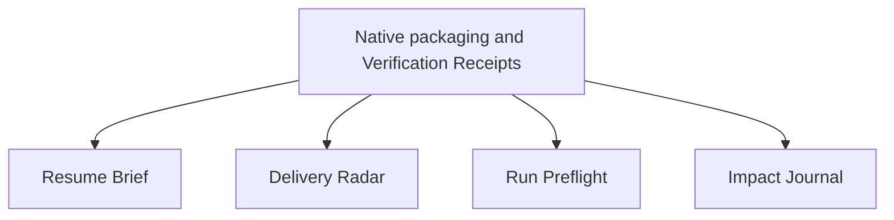

# Development Plan — Armory Native Runtime Extensions

## 1. Context & Source Map

Armory will distribute five optional self-contained native runtime extensions for OMP and Claude Code. Deterministic feature logic is shared; loading, effects, permissions, cancellation and UI remain native. This committed plan and its companion execution prompts are the complete extension-only contract: no private planning input or prior conversation is needed to execute it.

The current execution authorization covers the docs-only bootstrap and, after its reviewed green external merge and a current design GO, implementation through reviewed/current-green external merges and task-owned cleanup. It does not authorize experiments, model probes, benchmark campaigns, account switches, persistent owner installs, live-owner-vault writes, root version bumps, tags or manual release. Existing studies, frozen inputs and unrelated work remain unchanged.

| Requirement area | Accessible reference | Contract |
|---|---|---|
| Catalog scope, self-containment and metadata | `README.md`; `CONTRIBUTING.md`; `NEW_PACKAGE_CHECKLIST.md`; `scripts/package_types.py` | §17.1–§17.3; M9 and each feature |
| Native build, installation and distribution | `scripts/package.py`; `scripts/install.py`; `scripts/generate_adapters.py`; `.github/workflows/package.yml` | §17.3, §17.6–§17.7 |
| Type consumers, eval integrity and CI | `scripts/evaluate_package.py`; `scripts/validate_frontmatter.py`; `scripts/validate_references.py`; `scripts/validate_evals.py`; `scripts/run_evals.py`; `justfile`; `.github/workflows/tests.yml`; `.github/workflows/evals.yml` | M9 complete consumer migration; §17.7 |
| Historical population and treatment preservation | `scripts/validate_skillsbench.py`; `evals/skillsbench/README.md`; existing committed SkillsBench corpus, classification and run contracts | §7; §17.3; M9–M13 |
| Managed dispatch admission | `scripts/omp_skillsbench.py`; `scripts/omp_skillsbench_dispatch.py`, especially `dispatch_cell`; their existing tests | M12; §17.5, §17.7 |
| OMP factory registration and native loading | [Extension guide](https://github.com/can1357/oh-my-pi/blob/main/docs/extensions.md); [loading rules](https://github.com/can1357/oh-my-pi/blob/main/docs/extension-loading.md); actual installed host types/help | §17.3, §17.6–§17.7 |
| OMP handoff and session discovery | [Handoff pipeline](https://github.com/can1357/oh-my-pi/blob/main/docs/handoff-generation-pipeline.md); [session discovery](https://github.com/can1357/oh-my-pi/blob/main/docs/session-switching-and-recent-listing.md) | M10; §17.5 |
| Claude native modules, effects and validation | [Mods reference](https://code.claude.com/docs/en/plugins/mods/reference); [creation/static validation](https://code.claude.com/docs/en/plugins/mods/create); [native tests](https://code.claude.com/docs/en/plugins/mods/test); [effects/lifecycle API](https://code.claude.com/docs/en/plugins/mods/api); installed generated types | §17.3, §17.6–§17.7 |
| GitHub observation semantics | [GitHub CLI manual](https://cli.github.com/manual/); [pull request API](https://docs.github.com/en/rest/pulls); [checks API](https://docs.github.com/en/rest/checks); actual configured read-only CLI/API responses | M11; §17.5 |
| Tessera persistence | Selected supported Tessera client's versioned capture/list/read schemas and help; real isolated test-principal responses | M13; complete transport requirements in §17.5; resolve actual interface at the design gate, never infer cross-host tool availability |

Repository paths ground existing integration surfaces, not claims that extension tooling already exists. §17.7 explicitly identifies proposed commands and their owning milestone. Installed types and exercised behavior take precedence over online API signatures; compatibility claims require exact tested versions and surfaces.

## 2. Assumptions & Gaps

> ASSUMPTION: Optional extensions are a dedicated eighth package type, not disguised hooks/utilities; legacy package profiles retain their behavior.

> ASSUMPTION: Feature-owned TypeScript uses an `extensions/` Bun workspace without changing Python's uv manager. Shared pure code is bundled into native artifacts; runtime dependency installation on invocation is forbidden.

> ASSUMPTION: Package-local metadata starts at `1.0.0`; each feature has its own unversioned rolling train, with no root-version bump or independent publication operation.

> GAP: Host loading, runtime behavior, trust/policy approval and version-pinned CI host acquisition must be established by M9 before compatibility is advertised. A genuine human policy gate blocks only its affected scope; it is not bypassed or treated as successful static validation.

> GAP: M13 requires a working isolated Tessera test principal/vault and a supported transport for each host. An unavailable test prerequisite blocks M13, not independent M10–M12, and does not authorize a new database or daemon change.

> ASSUMPTION: Quota unavailable means unknown, not zero or capacity. Explicit bounded-run authority may acknowledge that uncertainty but cannot override existing study holds or unsupported financial enforcement.

`ISSUE_TRACKING: off` throughout. No architecture-choice gap requires moving these packages to a separate repository. Runtime prerequisites remain executable gates, not waived requirements.

## 3. Dependency Graph



The graph is independent after M9, not a chain of feature dependencies. Default implementation order is M9, M10, M11, M12, M13 because catalog/package/CI surfaces are shared. Concurrent product lanes require an explicit isolation/conflict design; read-only evidence gathering may be concurrent. A real external descendant blocker does not block other dependency-ready descendants.

## 4. Release Trains

| Target release | Included milestones | Preparation trigger | Required artifacts | Verification | Publication |
|---|---|---|---|---|---|
| `unversioned verification-receipts` | M9 | M9 externally merged with both native acceptance paths verified | none at train preparation; package definition/version and package CHANGELOG ship with implementation | §17.7 common gates plus `uv run python scripts/check_extensions.py --feature verification-receipts --native-smoke` | Existing main-triggered rolling latest only after authorized merge; no new tag or registry |
| `unversioned resume-brief` | M10 | M10 externally merged with both native acceptance paths verified | none at train preparation; package-local metadata and CHANGELOG ship with implementation | §17.7 plus `uv run python scripts/check_extensions.py --feature resume-brief --native-smoke` | Existing rolling latest; no separate publication command |
| `unversioned delivery-radar` | M11 | M11 externally merged with both native acceptance paths verified | none at train preparation; package-local metadata and CHANGELOG ship with implementation | §17.7 plus `uv run python scripts/check_extensions.py --feature delivery-radar --native-smoke` | Existing rolling latest; no separate publication command |
| `unversioned run-preflight` | M12 | M12 externally merged with both native acceptance paths verified | none at train preparation; package-local metadata and CHANGELOG ship with implementation | §17.7 plus `uv run python scripts/check_extensions.py --feature run-preflight --native-smoke` | Existing rolling latest; no separate publication command |
| `unversioned impact-journal` | M13 | M13 externally merged with both native acceptance paths verified | none at train preparation; package-local metadata and CHANGELOG ship with implementation | §17.7 plus `uv run python scripts/check_extensions.py --feature impact-journal --native-smoke` | Existing rolling latest; no separate publication command |

Package definition/version and package CHANGELOG are implementation deliverables, not deferred release preparation. All five trains require no separate preparation artifacts or release-captain work. Observe existing main-triggered rolling assets after authorized merges; do not initiate another publication, tag, registry upload or root-version bump.

## 5. Plan Evolution Protocol

- Authoritative paths are exactly `docs/runtime-extensions/DEVELOPMENT_PLAN.md` and `docs/runtime-extensions/EXECUTION_PROMPTS.md`. This is a deliberate prompt-level override of milestone-runner defaults, not automatic path discovery, a new CLI option or a change to the installed runner skill. Every design gate, lane, reconciliation and release check uses their current committed revision.
- The sole local history is `.docs/DEVELOPMENT_PLAN_HISTORY.md`, gitignored and never published. Only the canonical owner appends entries under `runtime-extensions/M9` through `runtime-extensions/M13`; no topic history or lane-written ledger. Verify the exact path is ignored; if needed add only that exact ignore rule. Rebuild missing evidence from committed artifacts, merged PRs, current source and provider CI.
- Before branches or product code, inspect the current milestone/prompt, source map, codebase, merged predecessor diffs/outcomes, current CI and predecessor verification evidence, plus local history when available. Use isolated read-only evidence lanes when available and recheck load-bearing citations. The canonical owner decides, updates the authoritative pair and controls topology/merges/cleanup.
- Record exactly one design verdict: `DESIGN GO — PLAN REVISION: none`, `DESIGN GO — PLAN REVISION: <entry IDs>`, or `DESIGN NO-GO — REASON: <blocking evidence>`. The ledger entry includes timestamp, milestone, decision, trigger, evidence, changed plan/prompt sections, downstream impact and implementation authorization.
- A material mismatch updates the current milestone and every directly/transitively affected descendant in both public artifacts, recomputing DAG, critical path and release membership when affected. The revision verdict records diagnosis only: a docs-only reconciliation PR must be reviewed, green and externally merged before code; repeat the gate afterward and require `DESIGN GO — PLAN REVISION: none`.
- NO-GO blocks affected code/branches/implementation PRs. A shared mismatch blocks the affected closure, not just one lane; no partial scaffolding while reconciliation is pending. A genuine independent external prerequisite does not block unrelated ready descendants.
- Use `stacked-prs`, Conventional Commits, atomic attribution-free commits, independently reviewable PRs and root-to-leaf promotion. Children start on the preceding branch until it merges. Conditional reconciliation roots are outside product PR estimates. No issue creation/edit/comment/label/closure is part of this campaign.
- Require per-PR reviews, whole-stack review and independent external gate verification. Do not solicit external/bot reviews or mention reviewers. Report unavailable isolation honestly; self-review is not independent. Require fresh current-head/base applicable CI after promotion, including main-only packaging, and cumulative acceptance again on the externally merged base.
- GO is merge eligibility, not a claim of external merge, runtime compatibility from signatures, or empirical effectiveness. The canonical owner observes actual merges, merged-base smoke and task-owned cleanup, then continues to the next ready milestone within existing authorization.

## 6. Sections & Milestones

### Section E — Optional Native Runtime Packages

The source map, resolved decisions, architecture, verification command definitions, privacy policy, and runner bootstrap for these milestones are in §17. All commands introduced by this program are **planned acceptance interfaces**, not existing commands or observed passing checks. M9 establishes their real implementation and CI before dependent use. `ISSUE_TRACKING: off` applies throughout.

#### M9 — Ship native packaging with cross-harness Verification Receipts

| Field | Value |
|---|---|
| Objective | Install and use an independently packaged Verification Receipts extension in OMP and Claude Code, with real command execution, durable evidence, and input-scoped invalidation. |
| In / Out of scope | In: eighth package type, native artifacts/lifecycle, minimal TS tooling, pure receipt rules, bounded process runner, catalog/CI integration, real-host proof. Out: generic compatibility framework, service/daemon, new memory database, arbitrary shell-command interception, existing package rewrites. |
| Depends on | none |
| Target release | `unversioned verification-receipts` |
| Deliverables | `extensions/verification-receipts/EXTENSION.md`, feature-owned core/adapters/runner/tests/evals/CHANGELOG, native self-contained builds, host-aware installer, capability/compatibility manifest, §17.7 verification driver, docs, and benchmark-population preservation. |
| Acceptance | A clean detached package in each real host executes a successful configured gate and a failed gate, preserves both exact results, and reloads the same evidence. Covered tracked/untracked/config input changes make success stale; unrelated edits do not. Covered input mutation during execution makes evidence unstable, never fresh. Cancellation kills the owned process tree and records cancelled/incomplete. Native install/update/disable/remove preserves foreign packages/configuration and receipts; same input produces identical native artifact bytes. Unsupported hosts fail explicitly without auto-installing in default/full profiles. Frozen seven-type benchmark membership and treatment pins stay unchanged. |
| Verification | §17.7 common gates; `uv run python -m pytest tests/test_package_types.py tests/test_install_skills.py tests/test_generate_adapters.py tests/test_validate_skillsbench.py -q`; `uv run python scripts/check_extensions.py --feature verification-receipts --native-smoke`; §17.7 receipt scenarios with exact resulting state assertions. Apply the default-authentication smoke contract; lifecycle/data targets remain disposable. |
| Design reevaluation | Recheck actual installed host types, loader entrypoints, package-type consumers, native test availability, permission/trust behavior, storage scope, source binding and historical benchmark identity. Review M10, M11, M12, M13 after any shared contract change. No dependency on existing live studies; their approval holds remain unchanged. |
| Risks & rollback | Trusted in-process code, command side effects, incomplete fingerprint scope, crash/rename races, automatic rolling assets. Default read-only except explicitly configured verification and owned installation paths; retain evidence outside install tree; disable/remove native artifacts and revert the stack as a unit, never delete receipts or foreign data. |
| Est. PRs | 4 |

#### M10 — Ship freshness-checked Resume Brief

| Field | Value |
|---|---|
| Objective | Reopen a selected project with an evidence-linked card that separates recorded context from current observations and never transfers mutation authority. |
| In / Out of scope | In: `/armory-brief`, explicit repository/artifact/session selection, host-specific handoff/session readers, discrepancy computation and text/native UI. Out: scanning all sessions/projects, transcript copying to another host, automatic resumption, an authoritative second plan or memory store. |
| Depends on | M9 |
| Target release | `unversioned resume-brief` |
| Deliverables | `extensions/resume-brief` with pure normalized card rules, bounded native session/artifact readers, evidence references, OMP and Claude renderers, fixtures, evals, standalone artifacts, operator docs and package CHANGELOG. |
| Acceptance | Card shows objective/plan revision, last verification with source, branch/worktree/PR, blockers/next action, and approval boundaries with origin/time/expiry. After recording a brief, changing branch, plan, or blocker yields a precise discrepancy and evidence pointer in both hosts. Missing/unreadable sources remain unknown; untrusted document instructions never execute. Fresh source identity cannot renew an old approval; host/account/session approvals are not imported as executable permission. Existing receipt source is referenced, not copied into a new verification ledger. |
| Verification | §17.7 common gates; `uv run python scripts/check_extensions.py --feature resume-brief --native-smoke`; a real temporary Git project and supported native session/handoff artifact are reopened after branch/plan/blocker mutation; observed card fields and referenced hashes match current state, while old authorizations stay non-executable. Apply §17.7 default-authentication smoke; session/handoff inputs are explicitly selected synthetic test sources, not unrelated owner sessions. |
| Design reevaluation | Inspect merged M9 artifact/storage APIs and current host session-discovery contracts. Review M11–M13 only when shared package/storage/identity contracts change; no artificial feature dependency. |
| Risks & rollback | Prompt injection, ambiguous repository aliases and session schemas, sensitive transcript leakage. Explicit scope/containment and typed allowlisted fields; no body copying by default; unknown-schema diagnostics; disable this feature without deleting project handoffs or receipts. |
| Est. PRs | 2 |

#### M11 — Ship selected-stack Delivery Radar

| Field | Value |
|---|---|
| Objective | Show actionable delivery state for a selected repository/stack without confusing historical green checks or reviews with current acceptance. |
| In / Out of scope | In: `/armory-delivery`, existing authenticated GitHub CLI read operations, selected PR dependency graph, head/base-bound CI/review observations, session/worktree correlation when observed, meaningful transition notices. Out: merges, reviewer solicitation/mentions, resolving threads, cleanup/publication, global orchestration or effort percentages. |
| Depends on | M9 |
| Target release | `unversioned delivery-radar` |
| Deliverables | `extensions/delivery-radar`, deterministic delivery-state rules, paginated GitHub read adapter, native views, session-bound refresh with cancellation, provenance-bearing snapshots, fixtures/evals/docs and package CHANGELOG. |
| Acceptance | A changed PR head leaves prior checks/reviews historical; new checks pending/unavailable never become green. Base changes invalidate integration evidence even when head is unchanged. Unresolved threads, review dismissal, merge conflicts, missing required-check policy, pagination failure and inaccessible GitHub remain distinct blocked/unknown states. Implementation, verification, external review, merge and publication are separate facts with head/base/time/source bindings. Next action is agent work, external wait or owner decision. Identical snapshots produce no repeat notification; no timer survives unload/session exit and no mutation API is invoked. |
| Verification | §17.7 common gates; `uv run python scripts/check_extensions.py --feature delivery-radar --native-smoke`; protocol-faithful paginated fixtures exercise head/base changes, dismissed/unresolved reviews, pending/missing checks and rate limits. Real read-only native-host smoke inspects one explicitly selected public PR using current configured auth; record exact head/base and observed unknowns, without changing the PR. Apply §17.7 default-authentication smoke without a second OAuth flow or account change. |
| Design reevaluation | Inspect merged M9 lifecycle and current GitHub CLI/API fields and required-check visibility. No reliance on cached check counts or mergeable boolean alone. Review M10/M12/M13 only for changes to shared identity/lifecycle contracts. |
| Risks & rollback | API eventual consistency, rate limits and cross-account leakage. Bound scope/request count and refresh interval; cancel in-flight requests, label observation time/unknowns, keep account context, read-only command allowlist and inert escaped repo-controlled strings. Remove feature to stop refresh; no remote state rollback needed. |
| Est. PRs | 2 |

#### M12 — Ship Run Preflight for one existing managed runner boundary

| Field | Value |
|---|---|
| Objective | Check a declared OMP SkillsBench cell/run before its managed dispatch boundary and refuse stale, missing or unauthorized prerequisites without making a paid call during development. |
| In / Out of scope | In: `/armory-preflight`, one versioned OMP SkillsBench adapter, normalized ready/blocked/unknown report, provider/profile identity without secrets, declared worker/call/cap/checkpoint/source bindings, managed dispatch admission immediately before invocation. Out: universal spend guard, new benchmark campaign, account switching, changes to existing study approvals, quota scraping, making the existing preflight-only CLI a general live launcher. |
| Depends on | M9 |
| Target release | `unversioned run-preflight` |
| Deliverables | `extensions/run-preflight`; self-contained declaration/report core and native adapters; a project-local integration at `scripts/omp_skillsbench_dispatch.py:dispatch_cell` consuming an explicit admission record; compatibility docs; no-cost integration scenarios, evals, native artifacts and package CHANGELOG. |
| Acceptance | Missing input/auth attestation or required authorization blocks managed dispatch before spawning; unavailable quota yields unknown with timestamp/reason, not capacity. Changed source/config/data/account/cell/cap/checkpoint or expired observation refuses the record immediately before dispatch. Declare required facts versus advisory quota; quota unknown never yields fully ready, and managed launch requires fresh capacity evidence or separately explicit bounded-run authority acknowledging unknown quota. A fresh valid synthetic declaration reaches a local sentinel child exactly once; a stale one reaches it zero times. Existing runner limits own enforcement; extension never claims dollar enforcement the runner lacks. Existing study live holds remain effective, and legacy unobserved calls are not relabeled as managed. |
| Verification | §17.7 common gates; `uv run python -m pytest tests/test_omp_skillsbench.py tests/test_omp_skillsbench_dispatch.py -q`; `uv run python scripts/omp_skillsbench.py --preflight`; `uv run python scripts/omp_skillsbench_dispatch.py --preflight`; `uv run python scripts/check_extensions.py --feature run-preflight --native-smoke`. In both hosts, use real process execution with a harmless sentinel instead of any hosted model; validate blocked/unknown/fresh/stale/expired/source-race paths and zero provider calls. Apply §17.7 default-authentication smoke; synthetic declarations never inherit live-profile campaign authority. |
| Design reevaluation | Re-read frozen run contracts and `dispatch_cell`, current target/profile/quota observability, existing time/token bounds and separate approval rules. If the runner cannot enforce a declared cap, report unsupported/blocked; do not build a new campaign or weaken the cap. Shared contract changes re-review M10/M11/M13; empirical existing empirical studies remain separate. |
| Risks & rollback | Preflight-to-spawn race, forged status booleans, secret exposure, apparent bypass protection. Validate declared identities against current inputs at the actual owned spawn boundary; document scope and trust limitations. Roll back adapter integration with feature, preserving frozen corpus/receipts and existing live approval gates. |
| Est. PRs | 2 |

#### M13 — Ship opt-in Impact Journal using Tessera

| Field | Value |
|---|---|
| Objective | Queue reviewable initiative-linked contribution drafts at meaningful boundaries and save only explicitly reviewed records through existing Tessera project captures. |
| In / Out of scope | In: `/armory-impact`, opt-in work context/principal, private pending queue, deterministic evidence-first draft, human correction/discard, initiative deduplication, linked outcome/correction records and selected follow-up date. Out: employee/productivity scoring, unattended business-impact claims, annual-review compiler, weekly scheduler/service, new Tessera daemon/schema, automatic account/context mixing. |
| Depends on | M9 |
| Target release | `unversioned impact-journal` |
| Deliverables | `extensions/impact-journal`, normalized contribution envelope and native review UI/text workflow, transport adapter to existing Tessera API, private pending queue, explicit capture confirmation, reconnect/reconciliation behavior, tests/evals/docs, native artifacts and package CHANGELOG. |
| Acceptance | Two sessions/PRs in one initiative produce one reviewable contribution with distinct source references, not duplicate achievements. Draft separates work, personal role, intended benefit, observed outcome and claim evidence; unknown remains unknown. Owner can correct attribution, skip, discard or save exact reviewed content. Headless run only queues. Durable save uses `project` captures under the selected principal; corrections/outcomes are distinct linked content, never metadata-only recapture-as-update. Lost write response cannot cause blind duplicate capture: reconcile exact record identity before retry or leave explicitly unresolved. Offline/401 leaves pending draft unsaved, not successful. Explicit retention and company/personal boundaries prevent cross-context export; no provider call or business claim invention. |
| Verification | §17.7 common gates; `uv run python scripts/check_extensions.py --feature impact-journal --native-smoke`; in both hosts exercise queue → edit → discard and queue → review → capture → linked correction against an isolated Tessera test principal/vault with real storage, then reopen/read exact content. Missing/denied transport produces unsaved state. Apply §17.7 default-authentication smoke for the coding host only: it never selects or authorizes the owner's live Tessera principal. Never use the owner's live vault or fabricate successful live proof when Tessera is unavailable. |
| Design reevaluation | Inspect current Tessera capture/list/read schemas, same-principal permissions, content deduplication and transport available to each host. Reuse existing caller-side workflow; daemon changes or an inaccessible test vault are an affected M13 blocker, not permission to invent a database. Review M10–M12 only for changes to common storage/identity contracts. |
| Risks & rollback | Sensitive work/attribution leakage, capture dedup collisions, ambiguous response and improper automatic claims. Explicit opt-in/context/approval, private queue with no automatic export, read-before-retry and linked corrections; uninstall preserves pending records and Tessera records, no automatic remote deletion. |
| Est. PRs | 2 |

## 7. Cross-Cutting Concerns and Frozen Identity Boundary

All features are trusted executable packages, not security sandboxes. Default behavior is read-only except explicitly configured verification, owned installation effects and explicitly reviewed isolated/test or user-authorized capture. Bound filesystem/network/process effects, redact public evidence, render repository-controlled strings inertly, and preserve host trust/cancellation semantics. No credential values, private transcripts, real-log fixtures or secret-derived examples enter Git or distributable artifacts.

Preserve the existing historical seven-type study population independently of the new eighth catalog type. Keep all seven included definitions, task matrix, model targets, run-contract contents, treatment definitions/condition digests, corpus/source pins and historical results byte-identical to their pre-extension identities. Extend only the existing excluded ledger and repair the validator's taxonomy coupling; retain exhaustive included/excluded classification and refusal on accidental sample changes. Do not re-freeze, re-derive, expand or rerun historical studies. Retain existing live-study, inventory/archive-mutation, exact-input, isolation, telemetry, authorization and spend holds; this campaign does not import or relax any old approval. The implementation must prove frozen identities unchanged, not merely report an unchanged count.

Each feature owns its docs, tests, evals, native artifacts and package CHANGELOG in its milestone. Installed artifacts remain self-contained offline; no import into a checkout or sibling package. Canonical evidence and pending drafts remain outside installation trees, and disable/removal never delete them. Unknown schemas, incomplete observations and unavailable capabilities fail explicitly without fabricated success. No generic cache warmer, silent prompt rewrite, memory collector, decorative global dashboard, screen-redaction security promise, daemon or universal spend controller is included.

## 8. Critical Path

| Path | Completion evidence | Release disposition |
|---|---|---|
| Docs-only bootstrap → M9 | Reviewed green bootstrap externally merged; current design GO; four-PR native packaging/receipts stack; both-host V1–V5/S1 and merged-base acceptance | `unversioned verification-receipts`; no separate preparation |
| M9 → M10 | Two-PR brief stack; B1/S1 plus common native gates and merged-base acceptance | `unversioned resume-brief`; no separate preparation |
| M9 → M11 | Two-PR delivery stack; D1/S1 plus common native gates and merged-base acceptance | `unversioned delivery-radar`; no separate preparation |
| M9 → M12 | Two-PR preflight stack; P1/S1 plus common native gates, real no-cost sentinel and merged-base acceptance | `unversioned run-preflight`; no separate preparation |
| M9 → M13 | Two-PR journal stack; I1/S1 plus common native gates, isolated real Tessera storage and merged-base acceptance | `unversioned impact-journal`; no separate preparation |

M9 is the shared prerequisite; completion requires all five independent paths, not only the default sequential order. There are 12 product PRs (4 + 2 + 2 + 2 + 2); bootstrap and any conditional reconciliation are outside those counts. Runtime trust or isolated-vault prerequisites can determine an affected path's completion without changing the dependency graph.

## 17. Cross-Harness Runtime Extension Design

### 17.1 Context, repository fit and source map

**Decision: keep native extensions in Armory as optional self-contained packages.** The catalog already owns reusable prompt and executable automation units. One feature with two native adapters fits that model; a separate repository would split discovery, provenance and lifecycle without eliminating host-specific maintenance. A persistent orchestration service, provider-spend controller or cross-product infrastructure with an independent operational lifecycle would require a different scope decision; all are non-goals here.

The §1 source map is the public grounding for every executable contract. Catalog taxonomy, metadata, eval and distribution consumers must be migrated together, not inferred from the presence of a directory. Native loading, actual behavior and permissions are proved separately from structural/type conformance. Shared schemas do not transfer host/session/account authority. Verification Receipts is the architecture proof before the other independent features; no existing study is its prerequisite.

| Requirement | Public grounding | Owning contract |
|---|---|---|
| Native entrypoints and portable deterministic rules, not portable authority | OMP extension/loading guides; Claude mods reference/create/API linked in §1 | §17.3, §17.6; M9–M13 |
| Dedicated optional type and complete consumer migration | Repository package registry, installer, evaluator, adapters, just/workflow maps | §17.3; M9 |
| Reproducible self-contained artifacts and safe lifecycle | `scripts/package.py`; contribution self-containment rules; packaging workflow | §17.3, §17.7; M9 and each package |
| Historical eligibility separate from current taxonomy | `scripts/validate_skillsbench.py`; existing committed SkillsBench classification/contracts | §7, §17.3; all milestones |
| Durable scoped verification | Complete envelope, scope, status and process contract below | §17.4; M9 |
| Freshness-checked selected project re-entry | Supported native handoff/session sources linked in §1 | §17.5; M10 |
| Head/base-aware read-only delivery state | GitHub CLI/API linked in §1; selected observed public PR | §17.5; M11 |
| Exact managed preflight admission | `scripts/omp_skillsbench_dispatch.py:dispatch_cell` and existing runner limits | §17.5; M12 |
| Reviewed contribution, not competing memory store | Existing Tessera capture/list/read schemas resolved at M13's gate | §17.5; M13 |
| Runtime compatibility distinct from static validation | Actual installed host types/help, strict native validation/tests and real smoke | §17.6–§17.7; all milestones |

### 17.2 Decisions, assumptions and bounded prerequisites

- Use a dedicated eighth type `extension`, under `extensions/<feature>/EXTENSION.md`, because native installation/runtime semantics differ from hooks and utilities. This is a new implementation requirement, not a claim of existing support.
- Use feature-owned TypeScript pure logic plus separate OMP and Claude adapters. Introduce a local Bun-managed workspace with `bun.lock` under `extensions/`, leaving Python's uv manager intact. Bundle runtime CLI/effect helpers as JavaScript with Bun as the explicitly supported initial runtime; document that dependency for Claude users. Do not silently require a checkout or download runtime dependencies on invocation.
- Literal public command names are `/armory-verify <gate>`, `/armory-evidence`, `/armory-brief`, `/armory-delivery`, `/armory-preflight <campaign>`, `/armory-impact`. Reject collisions rather than silently shadowing or renaming native/third-party commands.
- Each feature owns a package/version and unversioned rolling train, with initial metadata `1.0.0`. Host artifact metadata declares feature version, core digest/version, schema version, runtime requirements and exactly exercised host versions/surfaces. No root-version/tag/npm/PyPI release. Incompatible schemas require explicit refusal/migration, never silent reinterpretation.
- M9 must inspect the actual installed host types, loading entrypoints, help and behavior and establish both native acceptance paths. No hardcoded machine observations constitute minimum-version or compatibility certification. Use the installed supported package loader; an unrelated development checkout is not the compatibility gate.
- Resolve official version-pinned host installation in CI before claiming native gates available. Offline native tests/static validation do not establish approved interactive behavior. Automate launch/evidence capture, but retain genuine human trust/managed-policy stops without bypass or polling for a response.
- Native smoke may reuse the default authenticated host profile under §17.7 while retaining the normal operating-system HOME, credential store, principal and effective trust/enforcement. A fresh profile/login is not intrinsically required. This is data/artifact isolation, not full-profile isolation; ordinary host session/log/cache writes and ambient interference must be observed and disclosed. No credential export/substitution, account switch, keychain reset or policy change is authorized.
- M13 needs an isolated working test vault/principal and a supported real transport, with separate supported client credentials selected intentionally. Lack of that prerequisite blocks M13 only, not M9–M12, and does not justify daemon/schema/database changes.
- Missing quota remains unknown. Explicit bounded-run authorization can acknowledge uncertainty without claiming capacity; it cannot authorize an otherwise unauthorized run, clear existing study holds or assert unsupported dollar enforcement. This implementation authorizes no experiments, model probes, benchmark campaigns or account switching.
- `ISSUE_TRACKING: off`; default sequential execution after M9 avoids shared manifest/package/CI conflicts while preserving independent descendant dependencies.

### 17.3 Source ownership, catalog integration and native lifecycle

Canonical source is feature-owned:

```text
extensions/
  package.json
  bun.lock
  tsconfig.json
  eslint.config.js
  verification-receipts/
    EXTENSION.md
    CHANGELOG.md
    core/
    runner/
    omp/
    claude-code/
    tests/
    evals/cases.yaml
  resume-brief/
  delivery-radar/
  run-preflight/
  impact-journal/
```

Only actual features are created in their milestone; this diagram is not authorization to create empty future packages. `core` consumes normalized immutable data and has no Bun/Node/host imports, timers, filesystem or network effects. OMP and Claude adapters gather observations/render separately. Receipt execution, filesystem hashing and durable record effects justify a bundled helper used by both real adapters; do not generalize it into an event bus, capability framework, datastore abstraction or daemon. Extract cross-feature helpers only after two real consumers exist.

Native build outputs are generated outside canonical feature source, under `dist/extensions/<feature>/<host>/`; each artifact contains its adapter, exact shared core and required helpers/licenses. Claude imports remain static/relative inside its plugin, with all `$` calls explicit in the native module; imported pure helpers never receive `$`. OMP declares `omp.extensions` in its native package manifest. Claude declares `.claude-plugin/plugin.json` plus `hooks/hooks.json` module. Build verifies every referenced file is contained in its artifact, forbids links escaping the package, excludes local data/secrets/tests-only fixtures, records a content manifest, and produces reproducible bytes using existing packaging conventions. An offline installed invocation must not reach sibling packages, the repository, or npm.

M9 migrates every relevant registry consumer: discovery/manifest/search, type detection, frontmatter/reference/eval validation, report-v2 static conformance/effectiveness dimensions, Python installer, preset/profile expansion, archive packaging/release syncing, legacy plugin inventory, adapter generators, README/checklist/contribution schema, unit tests, just recipes and all workflow hardcoded type lists/maps. Audit actual references/impact before exported registry changes. Existing prompt adapters must explicitly skip unsupported native extensions; Gemini must not transform executable native modules into skill Markdown. The legacy all-in-one Claude plugin must not auto-enable every extension. Existing `core`, `developer`, `security`, `full` and “all” install paths preserve legacy behavior unless a caller explicitly selects a host-supported extension. Missing host support is diagnosed, never silently installed into `~/.claude/extensions`.

Add explicit metadata for supported hosts/native entrypoints, shared-core/schema identity, execution requirements, storage and permissions. Extend the registry with host-install semantics rather than misusing a single `install_subdir` for two hosts. `scripts/install.py` remains the catalog entrypoint; add `--platform omp` only for supported native extension operations, not a claim that old skills/agents are now ported. Proposed lifecycle interface: `uv run python scripts/install.py --type extension --platform <omp|claude> --name <feature> --action <install|update|disable|remove> --target-root <isolated-root> --yes`. Explicit extension selection and explicit action are required for noninteractive mutation. Retain old CLI semantics for old types; reject unsupported combinations.

Ownership manifest binds feature/host/version/root/files and previous configuration values. Stage/validate before activation; atomic replacement within owned directories, rollback on failure, no overwrite of foreign/locally modified files, no symlink traversal. Update affects only the selected feature/host; disable unregisters without deleting data; remove deletes only recorded unchanged owned files and exact registrations, preserving receipts/pending drafts/config siblings. Persistent install/enablement in the owner's real configuration is a separate authorization boundary; implementation smoke uses isolated roots and session-local plugin flags. Document real user installation/disable/removal commands derived from supported host mechanisms.

Keep historical experiments frozen. `validate_strata` must not couple frozen sample types to the expanding `set(TYPES)`; replace that accidental coupling with the explicit seven historically registered eligible types in the existing validator, while retaining exhaustive included/excluded catalog classification and rejecting accidental sample changes. New extensions go into the excluded ledger with a native-runtime-outside-original-study rationale. Do not change the seven included definitions, task matrix, targets, condition contents/digests, corpus pins or historical results; prove identities unchanged. This is a catalog-eligibility repair, not a benchmark expansion or instruction to re-freeze old evidence.

### 17.4 Verification record and execution contract

One local canonical receipt per execution, privately stored outside package/repository trees, with references from host sessions/project ledgers rather than cloned “current truth.” Default data root is an explicitly resolved user-private Armory state directory, partitioned by canonical repository identity, work context and host/account identity; worktree identity is a separate field. Store paths and command output privately; public/CI evidence uses synthetic repositories and sanitized version/status manifests. File mode `0600`, private directories, containment validation, exclusive record IDs, atomic finalized writes and interrupted-run reconciliation are required. Reject malformed/unknown schemas without overwriting prior evidence.

Envelope: schema/feature/core versions; execution ID; repository/worktree/host/session/account references; criterion/gate/config ID and digest; executable plus argument vector and cwd; configured timeout; start/end times and duration; exit/signal/cancellation status; immutable output artifact reference/digest and capture-limit/truncation marker; source revision/dirty state; declared covered files/config/environment/dataset identity; pre/post fingerprints and observation timestamps. No credential values or full inherited environment. Gate selection accepts an allowlisted configured ID, not shell text from model output or a repository document. Explicit invocation grants only that configured operation under current host policy, not arbitrary follow-on mutations.

Fingerprint each declared path set including existence/absence, tracked content, relevant untracked files, executable mode and selected config/data/environment identity. Resolve approved root once, reject escaping links/special files and configuration-derived path traversal. Include scope/config algorithm identity; relevant environment secrets may be keyed fingerprints only when needed, never plaintext. Snapshot membership as well as bytes so additions/deletions/renames invalidate. Hash before and after execution; source change during run yields unstable evidence, not fresh success. Document that pre/post equality cannot prove absence of transient modify-and-revert; no tamper-proof attestation claim. A revision string alone is insufficient; unrelated changes outside the declared scope do not invalidate.

Keep execution status (`passed`, `failed`, `cancelled`, `incomplete`) separate from applicability (`current`, `stale`, `unknown`) and from criterion kind (`unit`, `integration`, `live`, `human`, etc.). Exit 0 proves only the configured run result. Do not promote missing output, failed launch, denied permission, unknown input coverage or truncation-dependent acceptance into a successful proof. Concurrent writers cannot clobber records; readers see only complete finalized records, while interrupted records remain explicitly incomplete.

Bound process output, disk writes and runtime; preserve a private output artifact with an explicit cap/truncation diagnostic instead of unbounded RAM accumulation. Spawn executable/argv without shell interpolation, propagate host cancellation, terminate owned descendants and finalize the receipt. No implicit retries. The extension never hooks all arbitrary commands into successful verification; unobserved commands stay unobserved unless explicitly imported with original provenance.

### 17.5 Feature-specific contracts

**Resume Brief:** use explicit selected repository/artifact inputs and the current host's supported session/handoff discovery. Read only allowlisted structured fields, hashes and source references by default. Do not assume OMP `/handoff` creates a new session; do not equate a recent-session preview with full authoritative state. The card compares recorded/current observations, records unavailable sources and exact next action, and retains unresolved/expired approvals as holds. Commands and source text are inert data. No automatic resume execution or cross-host authority transfer.

**Delivery Radar:** use existing GitHub CLI authenticated read operations, never a second OAuth flow. Bind observations to repository/PR/head/base/observed-at/API visibility. Fetch all relevant pages with bounds; partial pages make the affected conclusion incomplete. Compare review commit identity and dismissal/unresolved thread state, not only aggregate approval count. Required-check policy unavailable means readiness unknown. Base identity changes invalidate tested integration without inventing GitHub semantics. Refresh on explicit command first; optional active-session timer uses cancellation and transition deduplication, bounded reads and no turns/model calls. Render a compact native/text view, not a global dashboard.

**Run Preflight:** target the existing OMP `dispatch_cell` callable, not an invented campaign service. A local project integration invokes feature logic using the installed/versioned package path declared by project configuration; the distributed extension itself never imports Armory's repository scripts. Declaration names runner adapter/version, target/cell or exact selected population, provider/profile/account identity source, calls/workers/concurrency, supported token/time/currency caps, source/config/data fingerprints, checkpoint output readiness, quota observation/time or unknown reason, and required authorizations. A status boolean is not an admission record. Bind the complete declaration and revalidate at the actual managed process-spawn boundary. Preserve existing preflight-only CLI and existing study refusal rules; no benchmark execution is required for feature acceptance. Test admission through the injectable runner with an actual local sentinel process. Unknown quota can coexist with explicit bounded-run authorization but remains unknown in the report; unsupported financial caps block a declared financial guarantee. The existing runner—not this UI—owns limits. Calls outside this integration remain outside its enforcement scope.

**Impact Journal:** reuse Tessera's existing `project` facet capture/read boundary, not agent-run retrospectives. Queue private agent drafts only for explicit selected delivery/investigation boundaries, with context/principal, initiative/event identity, work date, outcome date, capture date, source evidence, role/attribution, intended benefit, observed/unknown result, per-claim evidence status, review state and sensitivity. No per-turn questionnaire or automatic LLM calls. The first version supports deterministic evidence templates, explicit editing/review/discard/save, linked correction/outcome capture and a stored follow-up date surfaced on next invocation, not a scheduler or annual-report compiler.

Use one deliberately selected Tessera principal with distinct supported client credentials; do not copy credentials between hosts or store them in the package. Validate capture/list/read responses and permission scope. A transport may use native supported calls or an explicitly configured versioned Tessera client CLI through the host process API; resolve the actual installed interface at M13's gate, never assume an OMP MCP name is callable in Claude mods. No direct vault database access. For dedup, use stable initiative/event identity plus source/context, retain unknown-attribution states, and reconcile ambiguous writes before retry. A captured approved contribution and a later correction must have distinct linked content because identical-content recapture does not update metadata. Tests use an isolated test vault/principal, never the user's real durable records. Do not depend on default bounded semantic recall for complete initiative enumeration.

### 17.6 Native adapter and compatibility rules

OMP supports factory-based extension registration, commands/tools, session entries, widgets and overlays. Do not rely on header/footer setter signatures: use working widgets/custom/text surfaces and prove their behavior in the installed host. Extensions execute trusted in-process code; there is no sandbox guarantee. Use session/event-bound state rather than mutable module-global per-session data because factories may be reused across child sessions. Cancel timers and processes on disposal/session change; no background daemon.

Claude mods are native plugins with static `register(on, options)` modules. Effects stay explicit as `$.fs`, `$.process`, `$.http`, `$.clock`, native command/UI APIs or a bundled helper invoked through those APIs. No Node/Bun imports or ordinary timers inside the mod runtime, no passing `$` into imported functions, no dynamic imports or computed event/method discovery. Keep shared pure code within the plugin artifact. `claude plugin validate <dir> --strict --json` checks structure/static discovery; `claude plugin test <dir>` executes host-native offline tests, not a signed-in live session.

Terminal interactive is the initial supported UI for both hosts. Headless commands return machine-readable/text results without widgets or waiting for a person; Impact Journal queues rather than asks. Desktop/VS Code polished rendering is not promised; document observed text/unsupported capability behavior. Never claim all Claude surfaces equivalent. Native trust/policy remains authoritative even when the caller uses an implementation permission mode; do not alter approval policies to make smoke pass.

### 17.7 Verification surface and binary scenarios

The following new interfaces must be implemented in M9, documented in `--help`, tested with invalid arguments, and used unchanged in later milestones; they are not commands already present at planning time:

| Planned interface | Required outcome |
|---|---|
| `uv run python scripts/build_extensions.py --feature <name> --output-dir <path>` | Build both native artifacts; validate containment/metadata; identical sources yield identical bytes; fail on missing inputs. |
| `uv run python scripts/check_extensions.py --feature <name>` | Run native static/type/package/unit/integration gates for that feature; absent tools or no executed cases fail, never skip-green. |
| `uv run python scripts/check_extensions.py --feature <name> --native-smoke` | Additionally load detached artifacts in both actual installed hosts, exercise native commands, emit sanitized scenario/host/version/output evidence; missing host/trust makes this gate incomplete/nonzero. |
| `uv run python scripts/check_extensions.py --all --catalog` | Verify all registered extensions plus their native builds, catalog/evaluator/install/distribution consumers and compatibility metadata. |
| `uv run python scripts/check_extensions.py --feature <name> --stage core` (or `--stage omp`) | Explicit development-prefix gate for an unregistered feature. Run every implemented component's real applicable checks; emit the selected stage, `feature_complete=false`, and exact exercised/unavailable surfaces. Exit 0 certifies only that named stage, never native package compatibility. Default/full/native-smoke checks remain nonzero until complete. |
| `bun run --cwd extensions typecheck`; `bun run --cwd extensions lint`; `bun run --cwd extensions test`; `bun run --cwd extensions build` | Lockfile-bound TS `tsc --noEmit`, ESLint, deterministic core/native integration tests and production builds; each feature's tests must run rather than rely on counts. |

#### Prefix gates and catalog activation

An implementation prefix is not a released feature. Until the final package-bearing PR, omit `EXTENSION.md` and generated catalog/marketplace registrations; do not use dummy definitions, disabled-but-distributed stubs or advertised compatibility. Builders/discovery must select registered definitions, not blindly package every directory. Temporary native artifacts for stage smoke remain local/CI-only and are excluded from rolling release assets. The registry/type-schema additions can land without registering an incomplete feature.

| Prefix | Exact required gate in addition to applicable Python/TS/current repository checks | Feature activation |
|---|---|---|
| M9 PR-1 infrastructure | `uv run python -m pytest tests/test_extensions_packaging.py tests/test_package_types.py tests/test_install_skills.py tests/test_generate_adapters.py tests/test_validate_skillsbench.py -q`; packaging tests use self-contained fictional complete native fixtures and exercise build/check/install behavior. This new test module is a planned M9 deliverable. | No real feature registered. Native fixture validation is infrastructure evidence, not receipts compatibility. |
| M9 PR-2 receipt execution/core | `uv run python scripts/check_extensions.py --feature verification-receipts --stage core`; actual successful/failed/cancelled/changed-input/concurrent runner scenarios. | No definition/catalog/install/release entry; default full/native-smoke must report incomplete/nonzero. |
| M9 PR-3 OMP adapter | `uv run python scripts/check_extensions.py --feature verification-receipts --stage omp`; core gates plus actual detached OMP commands/process/persistence proof. | Still unregistered; only OMP stage is proven, no cross-host certification. |
| M9 PR-4 complete package | `uv run python scripts/check_extensions.py --feature verification-receipts --native-smoke`; `uv run python scripts/check_extensions.py --all --catalog`; full static evaluator/eval dry-run and detached lifecycle/distribution/compatibility checks. | Introduce definition/version/evals/catalog/CHANGELOG and both complete artifacts atomically in this PR. |
| M10–M13 PR-1 feature execution/core | `uv run python scripts/check_extensions.py --feature <that-feature> --stage core`; meaningful helper/integration scenarios, including real isolated storage for M13 and real managed sentinel for M12. | No definition or catalog/install/release entry for this feature. Existing complete registered extensions still pass their full gates. |
| M10–M13 PR-2 complete native package | `uv run python scripts/check_extensions.py --feature <that-feature> --native-smoke`; `uv run python scripts/check_extensions.py --all --catalog`; feature evaluator/eval dry-run and detached package/lifecycle checks. | Introduce complete package definition/version/evals/catalog/CHANGELOG and both artifacts together. |

CI selects this matrix from the committed implemented stage and files, never a caller-controlled “skip native” switch. A missing requirement inside the selected stage fails; an incomplete later stage is reported explicitly and cannot certify feature completion. Root-to-leaf merging does not activate a feature until its final package-bearing PR is present. All full milestone gates still apply cumulatively before the stack receives GO and again on the merged base; prefix-stage passes are not substitutes.


For Python changes run `uv sync --locked`, `uv run ruff check <changed Python paths>`, `uv run ruff format --check <changed Python paths>`, `uv run mypy --strict <changed Python modules>`, then targeted `uv run python -m pytest ...`. Run additional workspace-wide Ruff/format/strict-type checks where applicable and report unrelated existing failures without masking them. Full repository gates: `just check`; `uv run python scripts/validate_frontmatter.py`; `uv run python scripts/validate_references.py`; `uv run python scripts/validate_skillsbench.py`; `uv run python scripts/generate_adapters.py --validate`; `uv run python -m pytest tests/ -q`. Run static evaluator and eval dry-run for each changed extension: `uv run python scripts/evaluate_package.py --path extensions/<name> --json` and `uv run python scripts/run_evals.py --package extensions/<name> --dry-run`. Report-v2 conformance is not live effectiveness. Do not run paid evals to satisfy a structural check.

Add native TS/build/package/CLI gates to applicable PR workflows, including stacked bases, with tested pinned host binaries and Bun; do not fetch an unpinned remote install script in CI. Resolve the official version-pinned installation method during M9 before declaring the gate available. Existing GNU tar workflow remains Linux-owned; do not run its GNU-only flags against macOS BSD tar. After retarget/rebase require fresh applicable CI, including main-only packaging checks; re-run actual milestone smoke on the externally merged base. Test existing installation/generation routes so native support cannot break older types.

Native smoke is not another mocked test. Use temporary Git repositories, detached native package copies outside the development checkout, and explicit disposable feature data, pending-draft, receipt, output and lifecycle-install roots. Start installed `omp --plugin-dir <omp-artifact>` and `claude --plugin-dir <claude-artifact>` with no hosted model request; drive literal registered commands through their real interactive session or supported programmatic host path. Native test-kit stubs validate event contracts separately and cannot satisfy real-process receipt/sentinel/storage proof. Capture observable text/UI state, exit/cancellation behavior and persisted artifacts; verify headless behavior separately when advertised.

**Default-authentication smoke:** preserve the normal operating-system HOME and use the host's existing supported authenticated profile, credential store and principal. Do not replace HOME, require a new login solely for isolation, export/copy credential material, substitute an API/token identity or reset a keychain. Load only the test package through supported session-local flags, never a persistent install/enable action. Use supported disposable session/output roots where they do not change credential resolution or effective policy. Otherwise ordinary host session/log/cache writes are permitted and must be disclosed; do not claim full-profile isolation, a pristine host or absence of normal host writes. A fully disposable profile remains optional only when it is already usable through supported mechanisms without changing credentials/policy; absence of that optional mode is not a failure of default-authentication smoke.

Before launch derive controls from actual installed help and inventory effective plugins, hooks, MCP connections, trust and enforcement surfaces without exposing secrets or private content. Record host/version, selected mode, test roots, effective controls, ambient interference and observed ordinary profile effects in private evidence; public output contains only sanitized synthetic facts. Do not blindly enable ambient plugins or writers: use supported nonpersistent selection controls to prevent live-vault capture, background model requests and other out-of-envelope effects, while retaining managed and user enforcement. If unwanted effects cannot be contained without disabling enforcement, the affected smoke is blocked. Do not assume `--no-extensions` still permits the desired plugin, use safe/bypass modes that invalidate the test, alter approval rules, auto-answer a trust prompt or manufacture trusted state. Launch from an already genuinely trusted context when supported with the synthetic test repository explicitly selected; otherwise stop at the actual trust gate.

Default authentication changes no acceptance criterion. Both hosts must execute every required real-process scenario. Install/update/disable/remove and rollback proof always target disposable lifecycle roots with foreign-data sentinels, never the owner's persistent installation/configuration. Feature data and session-source tests remain explicitly scoped to synthetic disposable inputs; host authentication does not transfer approval to campaigns, another host or the live Tessera vault. Missing tools, genuine authentication/trust/policy prerequisites, unsafe ambient effects, or unexecuted cases remain incomplete/nonzero. Native smoke in CI uses the same effective-policy and containment rules with pinned hosts and supported provisioned prerequisites; static/native-kit passes cannot replace unavailable real-host proof.

| Scenario | Passing observable result |
|---|---|
| V1 configured success/failure | `/armory-verify` executes real local commands; receipts preserve exit 0 versus nonzero and output hash; failure never shows successful verification. |
| V2 freshness scope | Covered modification/add/delete/config change yields stale; unrelated edit remains current; source change during run yields unstable/unknown applicability; failed/cancelled status stays independent. |
| V3 persistence/lifecycle | Reopen both hosts against same approved evidence root; update/disable/remove only owned artifacts; receipts survive; another feature/foreign config remains byte-equal. Interrupted install recovers without partial activation. |
| V4 cancellation/concurrency | Cancel a real child with descendant sentinel; no owned descendant remains, incomplete/cancelled receipt is durable; concurrent receipts do not overwrite or expose partial records. |
| V5 native compatibility | Actual plugin loads from detached copy; commands registered and visible; Claude strict static validation/native tests pass; working OMP widget/text surface observed; no signature-only certification. |
| B1 brief discrepancy | Branch/plan/blocker changes show recorded/current mismatch and exact source; host/account approval remains a non-executable hold. |
| D1 delivery freshness | Old-head/base checks and reviews never imply current readiness; unresolved/missing/partial GitHub state remains blocked/unknown; read-only real public-PR observation matches recorded source IDs. |
| P1 preflight admission | Missing/expired/stale declaration spawns nothing; unknown quota remains unknown; fresh explicitly bounded synthetic authority spawns one harmless real child; no model call or existing-study launch. |
| I1 journal review | One initiative spans multiple sources; correction/discard changes draft; exact reviewed content persists only under isolated test principal; later outcome is linked; unavailable transport leaves unsaved draft. |
| S1 adversarial inputs | Traversal/escaping links, shell metacharacters in repo names, ANSI/Markdown injection, unknown schemas, changed install files and secret-bearing output cannot escape roots, execute unintended commands, overwrite foreign data or leak into public evidence. |

Keep permanent tests for plausible consumer-visible state/error/boundary regressions, not source wording, copied forwarding or nonempty-output checks. Fault/race scenarios are deterministic with synchronization, not sleeps. Temporary smoke scaffolds are removed only after evidence is retained outside distributable artifacts. Every package's docs and CHANGELOG ship with behavior; there is no later documentation-only “completion” milestone.

### 17.8 Runner authority, bootstrap and maximum automation

The authorized automation envelope is docs-only bootstrap, implementation, local/offline native checks, public-safe docs/code PRs, ordinary coding-agent work with existing authorized credentials, configured reviews, fresh CI, root-to-leaf external merges and verified task-owned cleanup. It includes §17.7 default-authentication smoke with normal HOME/keychain, disposable feature/artifact/lifecycle roots and disclosed ordinary host session/log/cache writes; it does not claim full-profile isolation. It excludes experiments, model probes, benchmark campaigns, account switches, live-owner-vault writes, persistent owner installs, root-version bumps, tags and manual releases. No new credentials, credential export/substitution, keychain reset or approval-policy changes are implied. Isolated real Tessera test storage is an acceptance dependency, never permission to use the owner's live durable records.

Bootstrap is a docs-only prerequisite outside product PR estimates. In an isolated worktree, publish only this self-contained extension contract and `docs/runtime-extensions/EXECUTION_PROMPTS.md`; preserve M9–M13 IDs, independent trains/DAG, complete architecture/scenarios and public source map. Use a docs-only `docs(plan): define native extension milestones` PR, review privacy and contract parity, require applicable green checks, merge externally, then reread the committed pair before M9. Do not commit private inputs, local evidence, sibling research or the history; do not replace another plan/prompt pair or invoke unrelated study goals.

For this campaign explicitly override milestone-runner's authoritative paths with `docs/runtime-extensions/DEVELOPMENT_PLAN.md` and `docs/runtime-extensions/EXECUTION_PROMPTS.md`. Every gate, reconciliation, lane input and release check uses those exact paths and current committed revision. No private shadow becomes authoritative. This is a prompt-level override, not a change to shipped runner behavior or an undocumented CLI option. Continue using only `.docs/DEVELOPMENT_PLAN_HISTORY.md` as the canonical ignored evidence ledger, with `runtime-extensions/M#` namespaces. Verify its ignore rule; never force-add it, create topic histories or allow implementation lanes to write it.

Before launch verify a clean canonical checkout and inspect current source, merged predecessor and CI evidence. The canonical owner alone records exactly one design verdict, appends ledger evidence, updates both public artifacts/every affected descendant, controls topology/issues/merges/cleanup and externally merges reviewed green docs-only reconciliation before code. Issue tracking is off, so no issue operations are requested. A diagnosis/revision verdict does not authorize implementation; repeat the design gate after reconciliation. Independent lanes gather evidence concurrently; implementation lanes return reviewed/current-green stacks and exact evidence, never claims of merging or ledger writes. They must report an extra-PR need before branching it and must not modify the authoritative pair. Per-PR/whole-stack reviews and an independent external gate verifier remain mandatory; missing independent isolation is reported honestly.

Default order is M9, M10, M11, M12, M13. After each verified merge rerun cumulative acceptance on the externally merged base, update canonical evidence, re-evaluate descendants and continue without another confirmation inside the authorized envelope. A real downstream external blocker retains its NO-GO while dependency-ready independent descendants proceed. Shared identity/package drift blocks the affected closure until reconciliation. Do not stop artificially at a milestone boundary or transient pending CI: await active jobs/checks through supported mechanisms, but never poll a human gate.

Every terminal result prints the design verdict first, then exactly one merge verdict: `GO — RELEASE: <declared target> — RELEASE PREP: not-required` or `NO-GO — RELEASE: <target> — REASON: <specific gate>`. GO requires current design GO, complete milestone acceptance, exercised local/native verification, every PR correctly based/reviewed/current-green and no unresolved manual gate. Pending checks, ambiguous readiness, missing independent review, scope drift, absent native proof or an unresolved release target are NO-GO. Follow with the literal heading `NEXT STEPS:` and an ordered list:

1. Current milestone: merge the reviewed stack, already merged, or stop on NO-GO, with observed evidence.
2. Release: `not-required` for preparation; state the rolling-train disposition and observe existing main assets without initiating publication.
3. Next milestone: name the next dependency-ready milestone with evidence, or `SKIP <current> FOR NOW; RUN <independent milestone> — independent of <blocked closure>`, or `none — <reason>`.
4. On NO-GO: specific remediation and exact retry gate; otherwise not applicable.

No release-captain PR is required: each train declares no separate preparation artifacts and package version/CHANGELOG already ship in implementation. Canonical completion is every M9–M13 acceptance criterion, reviewed/current-green externally merged PRs, actual merged-base smoke, preserved historical contracts/data and verified task-owned cleanup. Lane DONE is narrower: complete implementation, exercised verification, reviewed/current-green stack, evidence and verdict returned to the canonical owner; it excludes merge, ledger, release preparation and cleanup.

Genuine human trust/policy, missing credentials/permissions, unavailable supported host/test vault, unrelated dirty state or an out-of-envelope prerequisite produces an explicit affected-scope NO-GO. Never call a mocked/skipped path complete, switch accounts, weaken policy or broaden authority to achieve unattended execution. Do not repeatedly request approval for operations already covered by the kickoff.

### 17.9 Current executable limits

This plan defines requirements, not implemented compatibility or effectiveness results. All new interfaces in §17.7 are M9 deliverables; later goals may rely on them only after their actual implementation and predecessor acceptance. Static conformance, dry-run evals, type signatures, test-kit stubs, counts and stage-only passes cannot replace real detached-host behavior. Missing tools, trust, required data, storage or executed cases remain explicit incomplete/nonzero gates.

Runtime compatibility, pinned CI acquisition, host trust/policy and isolated Tessera transport are executable prerequisites, not reasons to omit acceptance. Preserve unknown observations and all original study/authorization boundaries. Product work begins only after the public bootstrap is externally merged and the current design gate authorizes the exact milestone.
